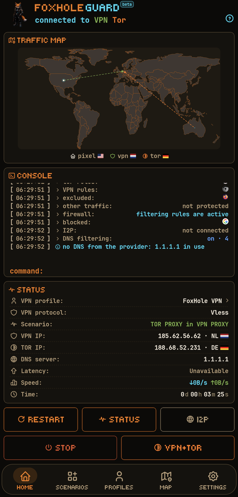
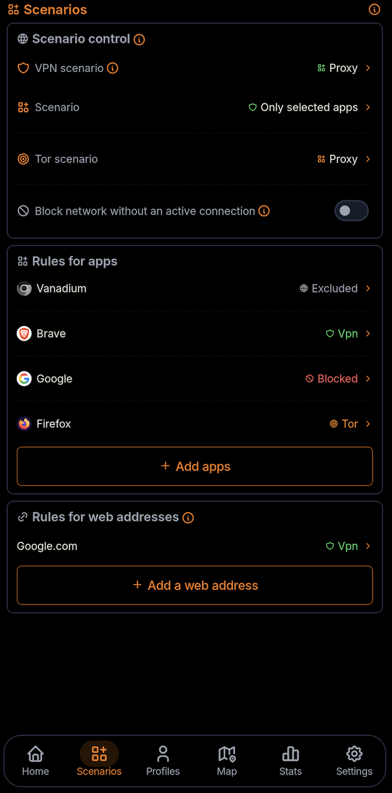
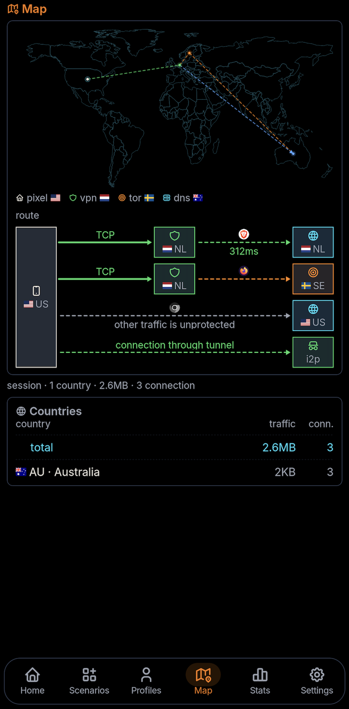
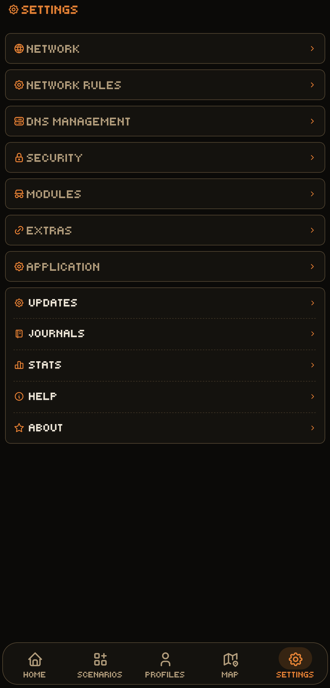

<h1 align="center">FoxHole Guard</h1>

<div align="center">

**FoxHole Guard** bietet Netzwerkschutz, Privatsphäre und die lokale Kontrolle der Netzwerkaktivität unter Android.

</div>

<p align="center">
    
</p>

<div align="center">

[](../README.md)
[](README.ru.md)
[](README.de.md)
[](README.fr.md)
[](README.es.md)
[](README.ja.md)
[](README.zh.md)

</div>

<p align="center">
  <a href="https://github.com/foxhole-team/foxhole-guard/releases">
    
  </a>
  
  <a href="https://f-droid.org/packages/com.foxhole.guard/">
    
  </a>
  <a href="https://apps.obtainium.imranr.dev/redirect?r=obtainium://app/%7B%22id%22%3A%22com.foxhole.guard%22%2C%22url%22%3A%22https%3A%2F%2Fgithub.com%2Ffoxhole-team%2Ffoxhole-guard%22%2C%22author%22%3A%22FoxHole%20Team%22%2C%22name%22%3A%22FoxHole%20Guard%22%2C%22preferredApkIndex%22%3A0%2C%22additionalSettings%22%3A%22%7B%5C%22apkFilterRegEx%5C%22%3A%5C%22arm64-v8a%5B.%5Dapk%24%5C%22%2C%5C%22invertAPKFilter%5C%22%3Afalse%2C%5C%22verifyLatestTag%5C%22%3Atrue%7D%22%2C%22overrideSource%22%3A%22GitHub%22%7D" title="Obtainium · ARM64">
    
  </a>
</p>


[](https://www.gnu.org/licenses/gpl-3.0.html)


Veröffentlichte Versionen und APK-Dateien stehen in [GitHub Releases](https://github.com/foxhole-team/foxhole-guard/releases).

Die Anwendung verbindet den eigenen, **in Rust geschriebenen FoxHole Core** mit VPN, Tor, I2P, lokaler Firewall, DNS-Filterung, Netzwerküberwachung, Web-Apps und Proxyserver.

**FoxHole Guard** enthält keine Werbung, Nutzungsanalyse oder Telemetrie. App-Listen, Statistiken, Protokolle, Routingregeln und lokale Analyseergebnisse bleiben auf dem Gerät, sofern der Benutzer sie nicht ausdrücklich exportiert.

|  |  |
| :---: | :---: |
|  |  |

---

<p align="center"><a href="#quickstart">Einstieg</a> · <a href="#features">Funktionen</a> · <a href="#details">Details</a> · <a href="#whats-new">Was ist neu</a></p>

<a id="whats-new"></a>

> **🆕 Was ist neu - 1.0.2 Stable**
>
> - Routersuche, Kopplung und OpenWrt-Prüfung über SSH korrigiert und Unterstützung für SSH-Schlüssel hinzugefügt.
> - Fehler beim Aktualisieren der App von GitHub behoben.
> - Einen Timer zum Schließen von Benachrichtigungen und das Schließen durch Wischen nach oben hinzugefügt.
> - Hilfe und Hinweise aktualisiert.
> - Die OpenWrt-Einrichtung und die Verwaltung von Heimgeräten und VPN-Clients vereinfacht.
> - Eine sechsstellige PIN mit Bestätigung bei der Installation und Unterstützung für bis zu 10 Router hinzugefügt.

<a id="quickstart"></a>

## ⬇️ Einstieg und Download

Android 8 (API 26) oder neuer ist erforderlich. Verfügbare APK-Architekturen stehen im veröffentlichten Release.

1. Ein APK aus [GitHub Releases](https://github.com/foxhole-team/foxhole-guard/releases) installieren.
2. Ein eigenes VPN-Profil hinzufügen oder das Tor-Modul aktivieren.
3. Ein Szenario wählen und beim Systemtunnel die Android-VPN-Anfrage bestätigen.

Obtainium · ARM64. Für andere Architekturen das APK unter [GitHub Releases](https://github.com/foxhole-team/foxhole-guard/releases) auswählen.

## 🔏 Release-Prüfung

Bei APKs aus einem offiziellen Release werden Prüfsummen- und Signaturzertifikatsprüfung empfohlen.

```bash
sha256sum -c SHA256SUMS
```

```bash
apksigner verify --print-certs downloaded-apk.apk
```

Erwarteter SHA-256-Fingerabdruck des Zertifikats:

```text
e59de2486084c38f3c77e9df0eb5eff9a4559f3c68024f1208e0e9c04b0df665
```

Erwarteter SHA-1-Fingerabdruck:

```text
9e00dc6b54461a4647cb11133b394cdfc986646d
```

---

<a id="features"></a>

## ✨ Hauptfunktionen

- **FoxHole Core** – eigener Netzwerkkern in Rust.
- **VPN-Protokolle** – VLESS, VMess, Hysteria2, WireGuard, AmneziaWG (experimentell), Trojan, Shadowsocks, Naive, TUIC und AnyTLS.
- **Tor-Zugang** – Tor in einem TCP-VPN-Tunnel, Routing ausgewählter Apps, Bridges und zeitgesteuerter Wechsel von Tor-Verbindungen.
- **I2P-Zugang** – `.i2p`-Ressourcen über einen eigenen `i2pd`-Prozess und einen lokalen SOCKS5-Vertrag mit FoxHole Core.
- **Firewall** – App-Sperren, Kill Switch und Quarantäne für neu installierte Apps.
- **DNS-Verwaltung** – lokaler DNS-Interceptor, UDP/TCP/DoT/DoH/DoQ/DoH3, Cache und veralteter Cache.
- **Verkehrskarte** – aktuelle Netzwerkverbindungen des Geräts auf einer Weltkarte.
- **FoxHole Sentinel** – optionale lokale IOC- und Netzwerkanomalieanalyse, standardmäßig deaktiviert.
- **Web-Apps** – HTML5-Anwendungen und Benachrichtigungen.
- **Proxyserver** – authentifizierter SOCKS5-/HTTP-CONNECT-Proxy im lokalen Netz.
- **Router-Verwaltung als öffentliche Beta (OpenWrt)** – Einrichtung, Kopplung, VPN-Profile, Geräterouting und Protokollpakete über die Einstellungen.
- **Hintergrunddienste** – `foxhole watchdog web` und `foxhole watchdog guard` für Web-App-Benachrichtigungen und Sicherheitsereignisse.
- **Sicherheit** – Hinweise auf Kompromittierung und Eingriffe: Installations-/Entfernungsprotokoll, Netzwerkanomalien sowie Prüfung neuer Apps auf Bedrohungsindikatoren und angeforderte Berechtigungen. Eigene Verschlüsselung von Anwendungsdaten wird unterstützt.

---

<a id="details"></a>

## 🧭 Architektur und Betriebsmodell

Ziel ist eine einzige Anwendung für alltäglichen Netzwerkschutz, VPN sowie die Anonymitätsnetze Tor und I2P, die Weiterleitung von App-Verkehr und das lokale Erkennen ungewöhnlicher Netzwerkaktivität und unbefugter App-Installationen. FoxHole Guard protokolliert Systemereignisse, Installationen, Entfernungen und Auffälligkeiten im Netzwerkverkehr.

### 🔁 Steuerungsablauf der Anwendung

```text
application
        ↓
operating mode  →  scenario  →  traffic routing rules
        ↓
modules  ·  extensions  ·  background services
```

- Der **Betriebsmodus** bestimmt, welche Verbindung – VPN und/oder Tor – den Android-System-VPN-Tunnel nutzt.
- Das **Szenario** bestimmt, wie VPN und Tor auf das Gerät angewendet werden.
- **Regeln** bestimmen die VPN-/Tor-Routen für Apps und Websites.
- **Module und Erweiterungen** arbeiten neben jedem aktiven Betriebsmodus.
- Aktivierte **Hintergrunddienste** laufen innerhalb der Android-Plattformbeschränkungen fortlaufend.

### 👤 Benutzer- und Expertenoberfläche

**Benutzer** zeigt das kompakte Dashboard, Verbindungssteuerung und Profilauswahl. **Experte** zeigt zusätzliche Diagnose- und Einstellmöglichkeiten. Diese Auswahl ändert die Darstellung; Routingregeln, Sicherheitszustimmung und erweiterte Einstellungen bleiben davon getrennt.

Wählen Sie Benutzer oder Experte in den Einstellungen oder bei der ersten Einrichtung des Erscheinungsbilds. Die inhaltsgroße Modusauswahl öffnet nach oben mit leichtem haptischem Feedback. Die OpenWrt-Verknüpfung auf der App-Startseite ist standardmäßig AN, die Dock-Verknüpfung AUS. Diese unabhängigen Einstellungen ändern nur die Sichtbarkeit der Symbole: OpenWrt-Einstellungen bleiben erreichbar, Router-/Routing-/Kopplungsrichtlinien bleiben unverändert.

### 🎛️ Betriebsmodi

Die Anwendung unterstützt drei Hauptmodi:

| Modus | Beschreibung |
| --- | --- |
| **VPN** | Normaler VPN-Tunnel. |
| **Tor** | Tor-Verbindung über Arti. Kein VPN-Profil erforderlich; das Tor-Modul muss aktiviert sein. |
| **VPN und Tor** | Beide Verbindungen gleichzeitig, jeweils mit eigenem Szenario. |

### 🧩 Szenarien

Ein Szenario steuert den Betriebsmodus. Im Modus **VPN und Tor** sind die Szenarien unabhängig.

| Szenario | Bedeutung | Verfügbar für |
| --- | --- | --- |
| **Gesamtes Gerät** | Gesamter Geräteverkehr durch den Tunnel. | VPN, Tor |
| **Proxy: ausgewählte Apps** | Nur ausgewählte Apps werden weitergeleitet. | VPN, Tor |
| **Proxy: alle außer ausgewählten Apps** | Alle anderen Apps werden weitergeleitet. | VPN |
| **Proxyserver** | Android-Proxyserver über die aktive Geräteverbindung. | VPN |
| **Proxyserver im lokalen Netz** | Lokaler Proxyserver über die aktive Geräteverbindung. | VPN, Tor, Mixed |

Für den gesamten Geräteverkehr über Tor gelten bei gleichzeitig aktivem VPN Einschränkungen. Läuft Tor außerhalb des VPN-Tunnels neben einem aktiven VPN, wird das Szenario für ausgewählte Apps verwendet. Im Mixed-Modus des lokalen Proxyservers läuft SOCKS5 über VPN, HTTP CONNECT dagegen über Tor.

### 🔀 Regeln für die Verkehrsweiterleitung

Regeln gelten innerhalb des aktiven Modus und Szenarios:

- App-Regeln steuern die Weiterleitung zwischen VPN und Tor;
- **Internetzugang sperren** und **von DNS-Filterung ausschließen** bleiben bei aktiviertem Firewall-Modul in allen drei Modi wirksam;
- Website-Regeln unterstützen Domains, Suffixe und CIDR-Bereiche;
- gesonderte DNS-Richtlinien werden unterstützt;
- Sperre bei Verbindungsverlust, Quarantäne neuer Apps und TTL-Regeln werden unterstützt.

| Regel | Gesamtes Gerät | Proxy-Szenarien |
| --- | --- | --- |
| App → VPN | nicht angewendet | angewendet |
| App → Tor | nicht angewendet | angewendet |
| App → ausschließen | angewendet | angewendet |
| App → sperren | angewendet | angewendet |
| Webadressregeln | angewendet | angewendet |
Im Szenario **Gesamtes Gerät** werden einzelne App-Zuweisungen zu VPN oder Tor nicht angewendet. Sperr- und Ausschlussregeln für Apps sowie Webadressregeln gelten weiterhin innerhalb der aktiven Route. App-Sperren benötigen einen laufenden Systemtunnel und eine aktive Firewall.

Routingregeln werden atomar angewendet. Auch Szenariowechsel erfolgen standardmäßig atomar; dies lässt sich in den Einstellungen deaktivieren.

---

## 🔒 Berechtigungen und Privatsphäre

- `INTERNET` – VPN, Proxy, Tor, I2P, DNS, Web-Apps, Abonnements und aktualisierbare Netzwerkdaten.
- `ACCESS_NETWORK_STATE` / `ACCESS_WIFI_STATE` – Netzwerkzustand, Regeln und Proxyserver.
- `ACCESS_LOCAL_NETWORK` - Router suchen, einrichten und verwalten. Unter Android 17 (API 37) oder neuer fordert die App bei Ziel-API 37 oder neuer vor LAN-Aktionen die Systemberechtigung an. Eine Ablehnung blockiert diese Aktionen.
- `FOREGROUND_SERVICE` und entsprechende Vordergrunddienstberechtigungen – länger laufende, vom Benutzer gesteuerte Netzwerkmodi mit sichtbarer Benachrichtigung.
- `QUERY_ALL_PACKAGES` – App-Liste für Split-Routing, Firewall, Quarantäne, DNS-Ausnahmen und lokale Prüfung.
- `PACKAGE_USAGE_STATS` – nur für aktivierte lokale Statistik-/Analysefunktionen, die den entsprechenden Android-Systemzugriff benötigen.
- `CAMERA` – QR-Import.
- `POST_NOTIFICATIONS` – Netzwerkdienste, Sentinel und Web-App-Benachrichtigungen.
- `RECEIVE_BOOT_COMPLETED` – Wiederherstellung des gewählten Modus nach Neustart.
- `WAKE_LOCK` – Aufrechterhaltung von Netzwerksitzungen, soweit erforderlich.

Folgende Daten bleiben auf dem Gerät:

- Liste installierter Apps;
- lokale Statistiken;
- Verbindungen und Protokolle;
- Sentinel-Ergebnisse;
- Verlauf automatischer Verbindungen;
- DNS-Ausnahmen;
- Firewall-Richtlinie;
- Routingrichtlinie;
- lokale Web-App-Daten;
- Modul- und Erweiterungseinstellungen;
- Vault-Metadaten.

FoxHole Guard sendet diese Daten nicht an den Entwickler.

### 🌍 Netzwerkanfragen

Updates der TLS-Fingerprinttabellen aus FoxHole DB sind standardmäßig aktiviert. Nach dem Start kann eine Prüfung erfolgen; weitere Prüfungen werden täglich bei vorhandenem Netzwerk geplant. Sie können in den Einstellungen deaktiviert werden. Andere signierte Datensätze und gespeicherte Abonnements besitzen eigene Aktualisierungseinstellungen.

Verbindungsprüfungen und IP-Abfragen kontaktieren externe Dienste, darunter Google, Cloudflare, ipwho.is und weitere Rückfallanbieter. Diese erhalten die Anfrage und die verwendete öffentliche IP-Adresse. Funktionsbedingte Netzwerkaktivität umfasst außerdem:

- VPN;
- Tor;
- I2P;
- HTTPS-Abonnementupdates;
- Verbindungsprüfungen;
- benutzerdefiniertes DNS;
- GeoIP-/DNS-/Tor-Bridge-Updates;
- Web-Apps;
- Ereigniszustellung für aktivierte Web-Apps.


Verbindungsprüfungen kontaktieren Google und Cloudflare. Externe IP-Dienste mit Ausweichadressen liefern die Ausgangs-IP und den ungefähren Standort. Sie sehen die Anfrage und die ausgehende IP-Adresse; Protokolle oder Sentinel-Ergebnisse werden dadurch nicht an den Entwickler gesendet.

Dienstanfragen umfassen außerdem App-Update-Prüfungen der GitHub-Version, ausgewählte FoxHole-DB-Daten-DNS, Tor-Brücken, GeoIP, IOC und TLS-Tabellen-sowie gespeicherte Abonnementquellen. Hintergrundprüfungen hängen von aktivierten Funktionen und Einstellungen ab. F-Droid verwaltet Updates seines APK selbst.

---

## 🧱 Module

Module werden unabhängig vom Betriebsmodus eingestellt. Soweit ihre Funktion keine aktive Netzwerkroute benötigt, können sie eigenständig arbeiten.

| Modul | Beschreibung |
| --- | --- |
| **Verkehrskarte** | Aktuelle Verbindungen auf einer Weltkarte. |
| **Statistiken** | Lokale Erfassung nach App, VPN-Profil und DNS-Filterung. |
| **Protokolle** | Anwendungs-, Netzwerk- und Sicherheitsprotokoll. |
| **Firewall** | App-Sperren und Quarantäne für neue Apps. |
| **Tor** | Arti: TCP, `.onion`, Bridges und zeitgesteuerter Verbindungswechsel. |
| **I2P** | `.i2p` über einen eigenen `i2pd`-Prozess und Loopback-SOCKS5. |
| **FoxHole Sentinel** | App-Prüfung, IOC-Abgleich und Protokoll mit Hash-Ketten-Integritätsprüfung. |
| **DNS** | DoT/DoH/DoQ/DoH3 und lokale Filterung. |

### 🧅 Tor-Zugang

Der Tor-Zugang verwendet **Arti**.

Unterstützt werden:

- Tor innerhalb eines TCP-VPN-Protokolls;
- Bridges;
- Sperren des Netzzugangs bei Verbindungsverlust;
- Wechsel von Tor-Verbindungen in einstellbaren Zeitabständen;
- Routing für ausgewählte Apps.

Das Tor-Modul gehört zum normalen Android-Build von FoxHole Core.

#### 🌐 Onion-Dienst

FoxHole Core enthält eine experimentelle API zur Veröffentlichung von Onion Services. Daraus folgt kein fertiger Veröffentlichungsablauf in der Guard-Oberfläche. Der Zugriff auf bestehende `.onion`-Seiten ist eine separate Funktion des Tor-Moduls.

### 🕸️ I2P-Zugang

I2P ist nicht innerhalb von FoxHole Core implementiert.

Ein ausschließlich TCP unterstützender Loopback-SOCKS5-Vertrag verbindet einen getrennten `i2pd`-Prozess.

I2P-Routenbedingungen werden ausfallsicher nach dem Fail-Closed-Prinzip geprüft:

- Zugriff auf `.i2p` für Apps, deren Verkehr über eine aktive FoxHole-Guard-Route läuft;
- Verkehrsweiterleitung in das I2P-Netz;
- Einschränkungen für Mobilfunknetze;
- Bandbreitenverwaltung.

Diese Route benötigt einen laufenden `i2pd` und DNS-Verarbeitung durch FoxHole Guard. Der strikte Private-DNS-Modus von Android ist mit der `.i2p`-Route unvereinbar; ihr Start wird mit einem Fehler abgelehnt.

### 🧱 Firewall

Die Firewall verwendet die gemeinsame Routingrichtlinie von FoxHole Core.

Unterstützt werden:

- App-Sperren;
- Vorrang von `Block` vor erlaubenden Routen;
- Regeln je App;
- Netzwerkquarantäne;
- TTL-Regeln;
- Kill Switch;
- sofortiger gezielter Entzug aktiver Stream-Proxy-Verbindungen nach einer Sperrregel; L3-Pakettunnel-Verbindungen bewerten die Richtlinie nach ihrem Leerlauf-Zeitlimit erneut;
- typisierte Fehler bei ungültigen Neuladungen.

### 🛡️ FoxHole Sentinel

FoxHole Sentinel ist das optionale lokale Sicherheitsüberwachungsmodul von FoxHole Guard. Es ist standardmäßig deaktiviert. Nach Aktivierung läuft die Hintergrundarbeit im Dienst `foxhole watchdog guard`.

Sentinel kombiniert unabhängige Signale aus Kompromittierungsindikatoren, Netzwerkaktivität, statischer App-Analyse und Verhaltensindikatoren. Ergebnisse werden lokal verarbeitet und nicht an den Entwickler gesendet.

Sentinel ist kein als Antivirus positioniertes Produkt. Es zeigt beobachtbare Indikatoren, deren Quellen und Vertrauensniveaus; bestätigte IOC-Treffer bleiben von heuristischen Vermutungen getrennt.

#### ✅ Implementiert

Derzeit umfasst FoxHole Sentinel:

- **Echap Stalkerware Indicators** – lokaler Abgleich bekannter Stalkerware-Indikatoren;
- **Netzwerk-IOC-Abgleich** – Abgleich der Live-Ereignisse von FoxHole Core mit bekannten Domains und IP-Adressen; über den Sentinel-Analyseschalter aktiviert;
- begrenzte APK-/DEX-Prüfung und optionale YARA-X-Regeln über verifizierte klassische DEX-Daten in einem isolierten Scannerprozess; unvollständige Abdeckung wird gemeldet;
- statische DEX-Struktur-/API-Referenzindikatoren ohne Ausführung von App-Code;
- statistische Warnungen bei Upload-, Hintergrund- und Gesamtverkehrsspitzen, neuen Zielländern, erhöhten DNS-Sperrquoten, Wiederverbindungsstürmen, Latenzänderungen und Netzwerkaktivität ruhender Apps;
- lokale Zuordnung erkannter IOCs zur App der Netzwerkverbindung;
- Integration mit Firewall und Quarantäne;
- Core-Ereignisprüfung über einen begrenzten Ereignisstrom.

Ein IOC-Treffer ist ein Sicherheitssignal, für sich allein aber kein abschließender Nachweis einer Gerätekompromittierung.

FoxHole Core führt kein dauerhaftes Guard-Benutzerprotokoll. Der Core stellt einen begrenzten Ereignisstrom bereit; das Android-Programm führt das Langzeitprotokoll. Bei überlastetem Empfänger meldet die Prüfschnittstelle ausdrücklich `dropped`-Ereignisse.

#### 🧪 Geplant

Die Architektur ermöglicht weitere lokale Analysen. Folgendes ist **noch nicht implementiert und nicht Bestandteil dieser Version**:

- Maschinencodeanalyse nativer Bibliotheken und umfassendere Packer-/Anti-Analyse-Erkennung;
- Verhaltensanalyse von DEX- und Android-API-Sequenzen;
- Zuordnung zu MITRE ATT&CK Mobile;
- erweiterte Analyse des App-Netzwerkverhaltens;
- Erkennung beaconartiger Aktivität;
- DGA-artige DNS-Indikatoren;
- umfangreichere Verhaltensbasislinien als die aktuellen begrenzten Verkehrsfenster;
- ein Korrelationsmodul, das statische, IOC-, Android- und Netzwerkbelege zu einem Befund verbindet.

Diese Detektoren sind lokal geplant, ohne Cloud-Scanning oder Übermittlung von APKs, installierten App-Listen oder Netzwerkverlauf.

#### 📜 Sicherheitsprotokoll

Die App kann ein verschlüsseltes lokales Protokoll führen mit:

- App-Installationen;
- Aktualisierungen;
- Entfernungen;
- Sicherheitsereignissen;
- ausgewählten Netzwerkereignissen.

Eine Hash-Kette ermöglicht die Integritätsprüfung.

---

## 🔌 Unterstützte Protokolle

| Protokoll / Modus | Unterstützung |
| --- | --- |
| **VLESS** | raw, WebSocket, HTTP Upgrade, gRPC/HTTP-2, XHTTP stream-one (HTTP/2), TLS, Reality, Vision, UDP-over-stream, XUDP, packetaddr |
| **VMess** | AEAD (`alterId=0`), raw, WebSocket, HTTP Upgrade, gRPC/HTTP-2, XHTTP stream-one (HTTP/2), TLS, TCP/UDP |
| **Hysteria2** | QUIC/H3, Authentifizierung, Brutal, TCP/UDP, Salamander-Obfs, Zielportwechsel über einen geschützten lokalen UDP-Socket, Wiederverbindung |
| **WireGuard** | eigener Noise_IKpsk2-Handshake, L3-Datenpfad, `reserved`, Import von `wg://` und `.conf` |
| **AmneziaWG** (experimentell) | `Jc/Jmin/Jmax/S1..S4/H1..H4`, geprüfte Headerbereiche, 2.0-Vorlagen `I1..I5`, `RandomTrailers`, Inhalts-Padding und `HeaderProtectionKey` |
| **Trojan** | TLS, WebSocket, HTTP Upgrade, gRPC/HTTP-2, XHTTP stream-one (HTTP/2), TCP/UDP |
| **Shadowsocks** | AEAD und AEAD-2022, TCP/UDP |
| **Outline** | Shadowsocks-Variante, kein eigenes Protokoll |
| **Naive** | natives HTTP/2 CONNECT mit Protokoll-Padding |
| **TUIC** | Clean-Room-v5, QUIC, TLS-Exporter-Authentifizierung, TCP/UDP, Fragmentierung, Wiederverbindung |
| **AnyTLS** | Clean-Room-v2, TLS-Authentifizierung, Padding, Sitzungswiederverwendung/Multiplexing, TCP und UoT-v2-UDP |
| **SOCKS5** | CONNECT, UDP ASSOCIATE, Authentifizierung |
| **HTTP-Proxy** | HTTP CONNECT, Authentifizierung |
| **Tor** | Arti, TCP, `.onion`, Bridges |
| **I2P** | reiner TCP-Loopback-SOCKS5-Adapter für einen getrennten `i2pd`-Prozess |

Reality ist eine Sicherheitsschicht unter den unterstützten Stream-Transporten, einschließlich XHTTP stream-one. Vision erfordert raw TCP. Andere XHTTP-Modi und nicht unterstützte Einstellungen werden abgelehnt.

### ↔️ Shadowsocks und Outline

Outline wird als Shadowsocks-Variante behandelt.

Profile akzeptieren Freigabelinks, v2rayTun-Abonnements, SIP008-JSON und kompatibles Clash-/mihomo-YAML. Dynamische Outline-Schlüssel (`ssconf://`) behalten ihre Quelle für Aktualisierung und Freigabe. Nicht unterstützte Einträge und Client-Einstellungen werden gemeldet; externe YAML-Provider werden nicht abgerufen.

Unterstützt werden:

- AEAD;
- AEAD-2022;
- Outline-`prefix=` für kompatible AEAD-Konfigurationen;
- SIP003-`v2ray-plugin` im WebSocket-Modus;
- `simple-obfs` in den Modi `http` und `tls`.

### 🚫 Nicht unterstützt

**ShadowsocksR (SSR)** ist veraltet und wird nicht unterstützt.

---

## 🌐 DNS

### 🧭 DNS-Verwaltung

FoxHole Core enthält einen eigenen DNS-Interceptor.

Unterstützt werden:

- UDP DNS;
- TCP DNS;
- DoT;
- DoH;
- DoQ und DoH3 mit eigener DNS-Serveradresse; Verfügbarkeit abhängig von Route und UDP-Unterstützung;
- geschützte DNS-Sockets;
- DNS-Bootstrap über ein bestimmtes Android-`Network`;
- Cache;
- veralteter Cache;
- Fake-IP;
- routenabhängiges DNS.

### 🧹 DNS-Filterung

FoxHole Guard kann lokale Regeln anwenden gegen:

- Werbung;
- Tracker;
- Telemetrie;
- potenziell schädliche Domains.

Die DNS-Filterung ist standardmäßig ausgeschaltet. Werbung, Tracker, Telemetrie und potenziell schädliche Domains lassen sich getrennt aktivieren. Für Tracker stehen Normal/Pro und für Bedrohungen Medium/Full zur Auswahl.

FoxHole DB erstellt die Datensätze aus festgelegten öffentlichen Quellen. Zusammensetzung, Quellrevisionen und Lizenzen stehen im jeweiligen Manifest und Herkunftsnachweis.

Das APK enthält Startdatensätze für alle vier Kombinationen. Die App prüft Größe, SHA-256 und verfügbare Kategorien; beim ersten Einsatz ist deshalb nicht zwingend ein Download nötig. Bei signierten Updates werden Signatur, Kompatibilität, Ablaufzeit, Versionsfolge und SHA-256 geprüft.

Update-Adresse der gewählten Variante:

`https://foxhole-team.github.io/foxhole-db/dns-categories/<variant>/manifest.json`

`<variant>`: `normal-medium`, `normal-full`, `pro-medium` oder `pro-full`.

Gespeicherte oder vorbereitete Daten sind noch nicht aktiv: Die aktuelle FoxHole-Core-Instanz muss sie prüfen und anwenden. Ungültige signierte active/pending-Daten werden als nicht verfügbar gemeldet und nicht still durch APK-Startdaten ersetzt. Die Datensätze enthalten Filterdaten, keinen ausführbaren Code.

---

## 🔐 TLS und geschützte Sockets

FoxHole Core verwendet einen Rust-TLS-Stack mit Zertifikatsprüfung.

Unterstützt werden:

- WebPKI-Prüfung;
- SNI;
- ALPN;
- SPKI-SHA-256-Pin;
- Kompatibilitätsmodus `insecure`.

`insecure` ist keine sichere Voreinstellung und erfordert ausdrückliche Zustimmung.

Jeder von FoxHole Core unter Android angelegte ausgehende Socket durchläuft:

```text
protect(fd)
    ↓
bind to Android Network
    ↓
connect / send
```

---

## 🧩 Erweiterungen und weitere Möglichkeiten

Erweiterungen ergänzen die Hauptanwendung.

| Erweiterung | Beschreibung |
| --- | --- |
| **Proxyserver** | Zugang für andere Geräte im aktuellen WLAN über SOCKS5 und HTTP CONNECT mit verpflichtender Authentifizierung und Bindung an ein bestätigtes Netzwerk. |
| **Web-Apps** | HTML5-Seiten im Vollbild-WebView mit regelmäßigen Benachrichtigungsprüfungen. Getrennte Speicherprofile werden verwendet, wenn das installierte WebView sie unterstützt. |

### 🔗 Proxyserver

Der Proxyserver teilt die aktive Route mit anderen Geräten im aktuellen WLAN.

- SOCKS5 und HTTP CONNECT;
- verpflichtende Authentifizierung;
- Netzwerkwechsel deaktivieren den Server und machen Zugangsdaten ungültig.

Routing-Voreinstellungen: VPN, Tor, Mixed – SOCKS5 über VPN, HTTP CONNECT über Tor.

### 🖥️ Web-Apps

Jede Web-App erhält eine eigene ASCII-Kennung, die FoxHole Core in der Routingrichtlinie verwendet.

- Identität und Speicherisolierung je Web-App: unterstützte WebView-Versionen nutzen getrennte Profile mit eigenen Cookies, Speicher und Cache; andernfalls ein gemeinsames Profil mit Browser-Origin-Isolierung;
- getrennte routbare Leases;
- Netzwerkregeln je Web-App;
- an die kanonische Origin-Identität gebundene Benachrichtigungen;
- Entzug erteilter Leases.

Die Datenbereinigung hängt vom installierten WebView ab: einzelnes App-Profil, Website-Daten oder gemeinsame Bereinigung nach gesonderter Bestätigung. Ohne Mehrprofil-Unterstützung teilen Web-Apps ein Profil mit üblicher Origin-Isolation. Ausstehende Bereinigungen werden erfasst und vor dem Laden wiederholt.

#### 🔔 Web-App-Hintergrunddienst – `foxhole watchdog web`

Ein eigener Hintergrunddienst stellt Web-App-Benachrichtigungen zu.

**Abfragemodell.** Der Dienst fragt aktivierte Web-Apps nach Zeitplan in einem unsichtbaren WebView ab: Ein JS-Shim liest den Website-Zähler oder ersatzweise `(N)` im Tab-Titel. Die Zustellung erfolgt periodisch, nicht in Echtzeit; das Intervall ist einstellbar. Ein prozessinterner Ticker steuert den Zeitplan, mit einem WorkManager-Durchlauf alle 15 Minuten als Rückfalllösung bei beendetem Prozess. Gleichzeitige Durchläufe werden zusammengeführt; Bilder werden nicht geladen.

**Abfragebedingungen.** Keine Abfrage erfolgt, wenn:

- die Route fehlt: VPN benötigt eine aktive Verbindung und eine verfügbare lokale Proxy-Brücke; WireGuard und AmneziaWG liefern diese nicht und werden dafür nicht genutzt; Tor benötigt einen aktiven Circuit, I2P eine aktive Verbindung; `BLOCK` verbietet die Abfrage immer;
- die WebView-Proxyüberschreibung nicht installiert ist: Sie gilt prozessweit und wird fail-closed geprüft; nur ein Loopback-Host mit verfügbarem Port und beiden Zugangsdatenwerten wird akzeptiert, andernfalls wird sie nicht angewendet.

**Nach der Abfrage.** Die Überschreibung wird entfernt und die Entfernung geprüft. Service-Worker-Netzwerkzugriff bleibt bis zum Routenwechsel gesperrt, damit kein Hintergrund-Worker außerhalb der neuen Überschreibung ins Netz gelangt. Ein Vordergrund-Frame besitzt die Überschreibung exklusiv: Währenddessen starten keine Hintergrunddurchläufe; ohne erlangte Zuständigkeit öffnet sich der Frame nicht. Er arbeitet nie außerhalb seiner zugewiesenen Route.

## 🛜 Router-Verwaltung als öffentliche Beta

> [!NOTE]
> Die Router-Verwaltung bei aktiver VPN-Verbindung wird derzeit noch nicht unterstützt.

Öffnen Sie OpenWrt in den Einstellungen, um einen Router zu koppeln und seine VPN-Profile, Geräterouten, Protokollpakete und FoxHole-Updates zu verwalten. Gerätekompatibilität sowie Installation und Updates werden noch geprüft. Der Verwaltungsschalter gilt für die ausgewählte gespeicherte Kopplung; sein Ausschalten stoppt das Router-VPN nicht.

> [!IMPORTANT]
> Die folgenden Einschränkungen beziehen sich auf die aktuell veröffentlichte Version.
> Die automatische Installation wird derzeit nur auf Routern mit unveränderter OpenWrt-Standardkonfiguration unterstützt.
> Die Kopplung ist auch nach der manuellen Installation der aktuellen Version von [FoxHole OpenWrt Client](https://github.com/foxhole-team/foxhole-openwrt-client) möglich.
> Für Einrichtung und Kopplung müssen sich Smartphone und Router im selben lokalen Netzwerk befinden; der Router benötigt Internetzugang.

Das WLAN-Symbol zeigt nur eine physische WLAN-Verbindung, ohne SSID oder Standortzugriff. Suche und neue Einrichtung/Kopplung erfordern WLAN. Die manuelle Adresse wird einmal mit dem aktuellen privaten IPv4-WLAN-Gateway vorbelegt, falls verfügbar, und bleibt bearbeitbar.

Über Heim-VPN verwalten ist eine separate Zustimmung und für jede bestehende Kopplung standardmäßig AUS. Zusätzlich sind Ihre Bestätigung Öffentliche IP-Adresse (der Router hat eine öffentliche IP und einen eingehenden VPN-Dienst) und eine nutzbare aktive VPN-Route erforderlich. Diese Bestätigung weist keine Adresse zu und konfiguriert keine Firewall. Die App kann die Verwaltung über dieses VPN-Netz am gespeicherten privaten Endpunkt mit bestehender TLS-Zertifikatsbindung und Kopplungsauthentifizierung versuchen; sie öffnet keinen WAN-Verwaltungsport und ermöglicht keine neue Suche/Kopplung über das Mobilfunknetz. Automatisches Umschalten/Handoff des Telefon-VPN bleibt deaktiviert; diese Zustimmung betrifft nur die Router-Verwaltung.

Separate App-Verknüpfungsmetadaten erhalten nur Profile für den eingehenden VPN-Zugang, die ein authentifizierter gekoppelter Router direkt an die App übergibt. Verbindungs-URI, Konfiguration und QR-Formate bleiben unverändert. Allgemeine Web-/QR-/Provider-Exporte bleiben unmarkiert; importierte Hinweise allein begründen kein Vertrauen.

Die automatische Erkennung erfordert außerdem das passende gespeicherte lokale Profil, dessen aktuelle Konfiguration und die ausgewählte Kopplung, während dieses Profil tatsächlich über das eigene App-VPN verbunden ist. Pro tatsächlicher Verbindung erfolgt eine begrenzte Prüfung, ohne Timer, automatische Wiederholung oder Provider-Profilabfragen. Kopplung wiederholen ist ein ausdrücklicher WLAN-/Berechtigungs-/PIN-Ablauf: Der alte Eintrag bleibt bis zur erfolgreichen Authentifizierung erhalten; eine geänderte Zertifikatsidentität wird nie stillschweigend akzeptiert.

Die Einrichtung erfordert OpenWrt 25.12.5 mit APK, Administratorzugriff und einen authentifizierten Katalog für die genaue Zielplattform und Architektur. Die aktuelle Paket-/Updaterichtlinie lässt `mediatek/filogic` und `x86/64` zu; damit ist nicht jedes Routermodell bestätigt. Abhängigkeiten, Kernel-ABI, Flash und RAM müssen ebenfalls die Prüfungen bestehen.

Bei der ersten Installation muss die Lizenz für FoxHole OpenWRT Client ausdrücklich akzeptiert werden; diese Auswahl ist zunächst nicht markiert. Das separate Kästchen für automatische Updates ist bei einer neuen Installation aktiviert: Deaktivieren Sie es bei Bedarf oder ändern Sie es später in den Router-Einstellungen. Die Kopplung eines vorhandenen Routers behält dessen Richtlinie bei. Bei direkter CLI-/Backend-Installation bleiben automatische Updates standardmäßig aus.

Manuelle Updates aus App und LuCI verwenden dieselbe authentifizierte Transaktion. Bei aktivierten automatischen Updates prüft der Router täglich und installiert verifizierte FoxHole-Pakete unabhängig vom Updatekanal der App. Profile, Kopplung und ausgewählte Protokollmodule bleiben erhalten; OpenWrt-Firmware und andere Systempakete werden nicht aktualisiert. Das Entkoppeln des Telefons deaktiviert die Routerrichtlinie nicht.

---

## ⚙️ Hintergrunddienste

FoxHole Guard nutzt zwei unabhängige Hintergrunddienste.

| Dienst | Funktion |
| --- | --- |
| **`foxhole watchdog web`** | Prüft und liefert Benachrichtigungen hinzugefügter Web-Apps. |
| **`foxhole watchdog guard`** | Überwacht Ereignisse und protokolliert App-Installationen/-Entfernungen sowie Verkehrsanomalien geschützt. |

Im gehärteten Modus startet `foxhole watchdog guard` ohne aktive Netzwerkverbindung einen Vordergrunddienst und stoppt ihn, sobald eine aktive Verbindung erkannt wird. Der Energiesparmodus verwendet periodische WorkManager-Abfragen.

---

## 🗃️ FoxHole DB und Datensätze

[](https://github.com/foxhole-team/foxhole-db)

FoxHole DB enthält fünf unabhängige signierte Datensätze, die nach Bedarf der jeweiligen Funktion heruntergeladen werden. Der TLS-Feed enthält nur Tabellen: ClientHello bleibt in FoxHole Core kompiliert. Bei fehlgeschlagenem Update werden eingebaute oder zuletzt verifizierte Tabellen weiterverwendet.

| Datensatz | Artefakt | Format | Quelle | Lizenz | Version |
| --- | --- | --- | --- | --- | --- |
| **DNS - Filterkategorien** | `dns-categories/<variant>/dns-categories.fhds` | `foxhole-dns-fst-v1`, Manifest `schema: 3` | Festgelegte Quellen von AdGuard, EasyPrivacy und HaGeZi; genaue Zusammensetzung im Manifest | Je Quelldatensatz; siehe Herkunftsnachweise | Vier Varianten: Normal/Pro × Medium/Full; APK-Startdaten und geprüfte Updates |
| **Tor – Spiegel eingebauter Bridges** | `bridges.json` | `tor-bridges-json` | [Tor Project built-in bridges (Moat)](https://bridges.torproject.org/moat/circumvention/builtin) | öffentliche Daten zur Zensurumgehung | `generated_at`; Objektschlüssel normalisiert, ursprüngliche Array-Reihenfolge erhalten. |
| **FoxHole Sentinel – Sicherheitslisten** | `threat-intel.json` | `sentinel-threat-intel-json`, Dokument `schema: 3` | [AssoEchap/stalkerware-indicators](https://github.com/AssoEchap/stalkerware-indicators) | CC-BY-4.0 | Upstream-Commit je Build festgelegt und in `threat-intel-source-info.json` aufgezeichnet. |
| **Geodatenbank – IP → Land** | `dbip-country-ipv4.csv`, `dbip-country-ipv6.csv` | `dbip-country-csv` | [DB-IP Lite via sapics/ip-location-db](https://github.com/sapics/ip-location-db) (`dbip-country`) | CC-BY-4.0 | Upstream-`version` aus `package.json` wird ins Manifest übernommen. |
| **TLS-Fingerprinttabellen – ClientHello-Profile** | `fingerprints.json` | `tls-fingerprint-tables-json` | [FoxHole Core `fingerprints/`](https://github.com/foxhole-team/foxhole-core) | GPL-3.0-or-later | Upstream-Revision je Build festgelegt; jedes Profil leitet vor Anwendung seinen `fingerprint_sha256` erneut ab. |

---

## 🤖 Android / Native ABI

Android 8 (API 26) oder neuer ist erforderlich. FoxHole Core ist über eine versionierte C/JNI-ABI angebunden; die Capabilities-API meldet die tatsächlich einkompilierten Protokolle und Funktionen.

Das Auslieferungsprofil `android4` zielt auf `arm64-v8a`, `armeabi-v7a`, `x86` und `x86_64`. Jedes ABI benötigt passende native Bibliotheken und Lizenzdaten. Verfügbare APK-Architekturen und Dateinamen ergeben sich aus der tatsächlich veröffentlichten Version; eine Build-Option allein bestätigt keine Geräte- oder Laufzeitkompatibilität.

Native Builds verwenden festgelegte Rust-/NDK-Toolchains und erfordern ELF-Prüfungen.

---

<a id="ecosystem"></a>

## 🔗 FoxHole-Ökosystem

| Projekt | Aufgabe |
| --- | --- |
| [**FoxHole Guard**](https://github.com/foxhole-team/foxhole-guard) | Android: VPN, Tor/I2P, Verkehrsregeln und lokale Überwachung |
| [FoxHole VPN](https://github.com/foxhole-team/foxhole-vpn) | Android: einfacher VPN-Client und gekoppelte OpenWrt-Verwaltung |
| [FoxHole Core](https://github.com/foxhole-team/foxhole-core) | Gemeinsamer Rust-Netzwerkkern; Umfang je Build |
| [FoxHole OpenWrt](https://github.com/foxhole-team/foxhole-openwrt-client) | Router-VPN und Verwaltung des lokalen Netzes |
| [FoxHole DB](https://github.com/foxhole-team/foxhole-db) | Signierte Regeln und Referenzdaten |

## 🤝 Mitwirken

Fehler und Änderungsvorschläge bitte über [Issues](https://github.com/foxhole-team/foxhole-guard/issues) melden.

## 💖 Entwicklung unterstützen

Wir entwickeln und pflegen FoxHole Guard vollständig mit unserer eigenen Zeit und unseren eigenen Mitteln und setzen bei der Entwicklung KI-Werkzeuge ein. Ihre Unterstützung hilft uns, dem Projekt mehr Zeit zu widmen und die Entwicklung zu beschleunigen.

<a id="cryptocurrency-wallets"></a>

### 🪙 Kryptowährungs-Wallets

**XMR (Monero):**

```text
48yBVPTdcyJ1WoJtnKmVpEZziEsDy4HvbCW7eQDS9mfdiWPFXwZ8F5h9YZ2UTTBLxPcJgQgvth7iqLZM2yMCaQ432qaouqr
```

**BTC (Bitcoin):**

```text
bc1qatnyy7jcpqrp0d3dk9rta9vqfejgh4mysd6m2f
```

**ETH (Ethereum):**

```text
0xDEBA357Cc8f5E865ea7FFa98E138C8241A16A465
```

---

## ⚠️ Haftungsausschluss

- Tor ist eine Marke von The Tor Project. FoxHole Guard ist kein Produkt von The Tor Project und wird weder von diesem empfohlen oder finanziert, noch ist es damit verbunden.
- FoxHole Guard ist kein Produkt von AdGuard und nicht mit AdGuard Software Ltd. verbunden.
- FoxHole Guard ist kein offizielles Produkt von I2P oder PurpleI2P.

## 📄 Lizenzen

FoxHole Guard und FoxHole Core werden vertrieben unter:

**GNU General Public License v3.0 oder später (`GPL-3.0-or-later`)**

Copyright (C) 2026 FOXHOLE TEAM.

Lizenzen von Drittanbieterabhängigkeiten stehen in:

- `THIRD_PARTY_NOTICES.md`;
- der Projekt-SBOM (`*.cdx.json`).

Der Abhängigkeits- und Lizenzgraph wird in CI geprüft.

---
