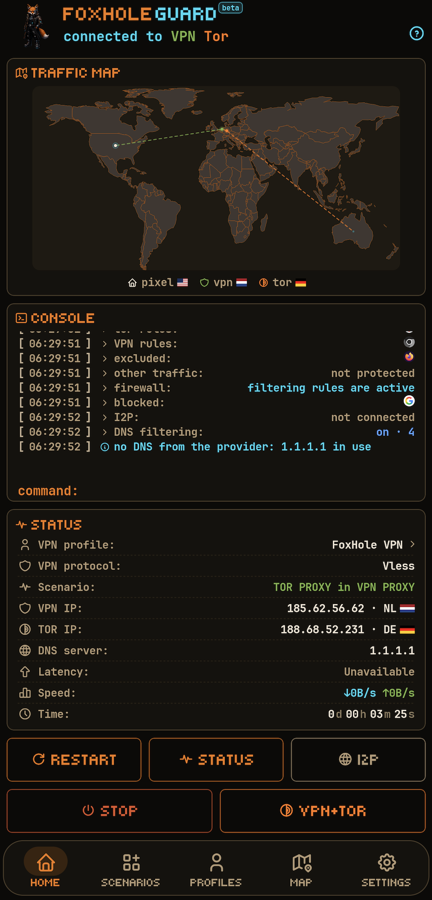
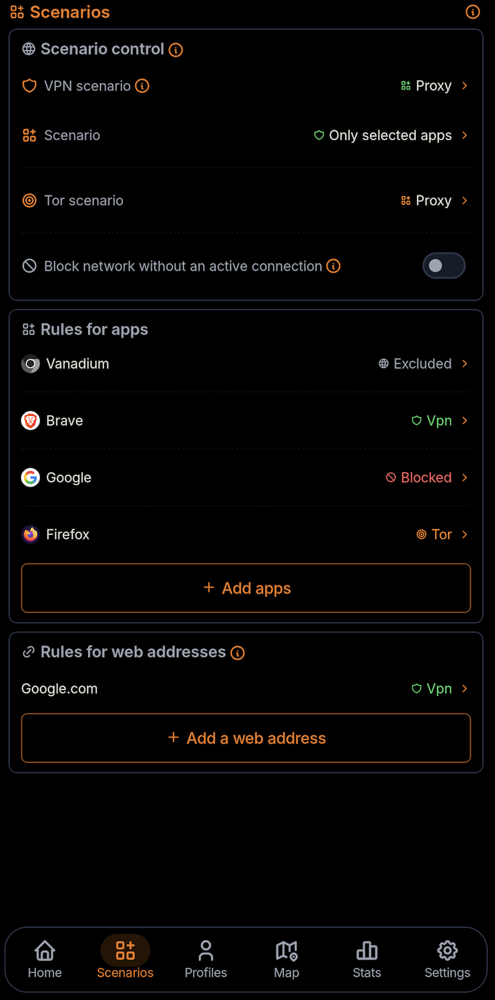
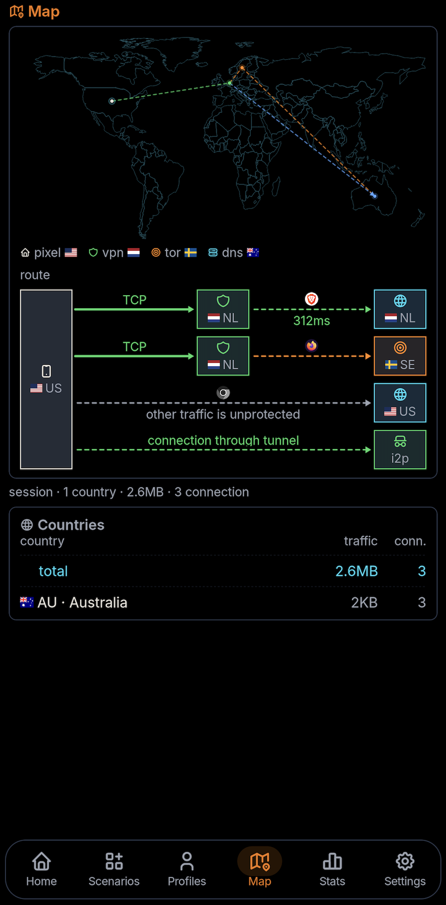
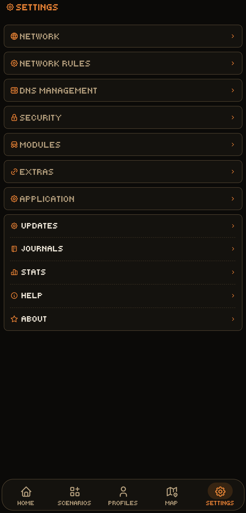

<h1 align="center">FoxHole Guard</h1>

<div align="center">

**FoxHole Guard** réunit protection réseau, confidentialité et contrôle local de l’activité réseau sur Android.

</div>

<p align="center">
    
</p>

<div align="center">

[English](../README.md) · [Русский](README.ru.md) · [Deutsch](README.de.md) · [Français](README.fr.md) · [Español](README.es.md) · [日本語](README.ja.md) · [简体中文](README.zh.md) · [العربية](README.ar.md)

</div>

<p align="center">
  <a href="https://github.com/foxhole-team/foxhole-guard/releases"></a>
  
  <a href="https://f-droid.org/packages/com.foxhole.guard/"></a>
  <a href="https://apps.obtainium.imranr.dev/redirect?r=obtainium://app/%7B%22id%22%3A%22com.foxhole.guard%22%2C%22url%22%3A%22https%3A%2F%2Fgithub.com%2Ffoxhole-team%2Ffoxhole-guard%22%2C%22author%22%3A%22FoxHole%20Team%22%2C%22name%22%3A%22FoxHole%20Guard%22%2C%22preferredApkIndex%22%3A0%2C%22additionalSettings%22%3A%22%7B%5C%22apkFilterRegEx%5C%22%3A%5C%22arm64-v8a%5B.%5Dapk%24%5C%22%2C%5C%22invertAPKFilter%5C%22%3Afalse%2C%5C%22verifyLatestTag%5C%22%3Atrue%7D%22%2C%22overrideSource%22%3A%22GitHub%22%7D" title="Obtainium · ARM64"></a>
</p>


[](https://www.gnu.org/licenses/gpl-3.0.html)


<p align="center">
  <strong>Version VPN uniquement</strong><br>
  <strong>FoxHole VPN</strong> — un client VPN simplifié pour Android basé sur FoxHole Core,<br>
  sans les outils supplémentaires de protection et de surveillance de Guard.
</p>

<p align="center">
  <a href="https://github.com/foxhole-team/foxhole-vpn"><strong>En savoir plus sur FoxHole VPN →</strong></a>
  &nbsp;·&nbsp;
  <a href="https://github.com/foxhole-team/foxhole-vpn/releases">Télécharger l’APK</a>
</p>

Les versions publiées et les APK figurent dans [GitHub Releases](https://github.com/foxhole-team/foxhole-guard/releases).

L’application associe son propre **FoxHole Core natif écrit en Rust**, VPN, Tor, I2P, pare-feu local, filtrage DNS, surveillance réseau, applications web et serveur mandataire.

Le projet propose une application unique pour la protection quotidienne, l’accès au VPN et aux réseaux anonymes Tor et I2P, le routage du trafic des applications et la détection locale d’activités réseau inhabituelles ou d’installations non autorisées. FoxHole Guard journalise les événements système, les installations, les suppressions et les anomalies du trafic réseau.

**FoxHole Guard** ne contient ni publicité, ni analyse d’utilisation, ni télémétrie. Les listes d’applications, statistiques, journaux, règles et résultats d’analyse restent sur l’appareil, sauf exportation explicite par l’utilisateur.

|  |  |
| :---: | :---: |
|  |  |

---

<p align="center"><a href="#quickstart">Démarrer</a> · <a href="#features">Fonctions</a> · <a href="#details">Détails</a> · <a href="#whats-new">Nouveautés</a></p>

<a id="whats-new"></a>

> **🆕 Nouveautés - 1.0.6 Stable**
>
> - Ajout de la prise en charge d’Android 7.
> - Filtres de routage des adresses web améliorés.
> - Style visuel des notifications amélioré.

<a id="quickstart"></a>

## ⬇️ Démarrage et téléchargement

Android 7 (API 24) ou ultérieur est requis. Les architectures APK disponibles sont indiquées dans la version publiée.

1. Installez un APK.
2. Ajoutez votre profil VPN ou activez le module Tor.
3. Choisissez un scénario et confirmez la demande VPN Android au démarrage du tunnel système.

## 🔏 Vérification des publications

Pour un APK issu d’une publication officielle, il est conseillé de vérifier somme de contrôle et certificat de signature.

```bash
sha256sum -c SHA256SUMS
```

```bash
apksigner verify --print-certs downloaded-apk.apk
```

Empreinte SHA-256 attendue du certificat :

```text
e59de2486084c38f3c77e9df0eb5eff9a4559f3c68024f1208e0e9c04b0df665
```

Empreinte SHA-1 attendue :

```text
9e00dc6b54461a4647cb11133b394cdfc986646d
```

---

<a id="features"></a>

## ✨ Fonctionnalités principales

- **FoxHole Core** – moteur réseau personnalisé en Rust.
- **Protocoles VPN** – VLESS, VMess, Hysteria2, WireGuard, AmneziaWG (expérimental), Trojan, Shadowsocks, Naive, TUIC et AnyTLS.
- **Accès Tor** – Tor dans un tunnel VPN TCP, routage d’applications sélectionnées, ponts et rotation programmée des circuits.
- **Accès I2P** – ressources `.i2p` via un processus `i2pd` distinct et une interface SOCKS5 locale avec FoxHole Core.
- **Pare-feu** – blocage d’applications, coupe-circuit et quarantaine des nouvelles installations.
- **Gestion DNS** – intercepteur local, UDP/TCP/DoT/DoH/DoQ/DoH3, cache et cache périmé.
- **Carte du trafic** – connexions réseau actuelles sur une carte mondiale.
- **FoxHole Sentinel** – analyse locale facultative des IOC et anomalies réseau, désactivée par défaut.
- **Applications web** – applications HTML5 et notifications.
- **Serveur mandataire** – SOCKS5 et HTTP CONNECT authentifiés sur le réseau local.
- **Gestion du routeur en bêta publique (OpenWrt)** – configuration, association, profils VPN, routes des appareils et paquets de protocoles depuis les paramètres.
- **Services en arrière-plan** – `foxhole watchdog web` et `foxhole watchdog guard` pour les notifications web et la surveillance des événements de sécurité.
- **Sécurité** – recherche de signes de compromission ou d’interférence : journal des installations/suppressions, analyse des anomalies réseau et vérification des indicateurs de menace et autorisations des nouvelles applications. Le chiffrement personnalisé des données est pris en charge.

---

<a id="details"></a>

## 🧭 Architecture et fonctionnement

### 🔁 Flux de contrôle de l’application

```text
application
        ↓
operating mode  →  scenario  →  traffic routing rules
        ↓
modules  ·  extensions  ·  background services
```

- Le **mode** détermine quelle connexion, VPN et/ou Tor, utilise le tunnel VPN système Android.
- Le **scénario** définit comment le VPN et Tor s’appliquent à l’appareil.
- Les **règles** déterminent les routes VPN/Tor des applications et sites.
- Les **modules et extensions** fonctionnent parallèlement à tout mode actif.
- Les **services en arrière-plan** activés s’exécutent dans les limites imposées par Android.

### 👤 Interfaces utilisateur et expert

**Utilisateur** présente le tableau de bord compact, les commandes de connexion et le sélecteur de profils. **Expert** ajoute les diagnostics et réglages. Ce choix change la présentation ; les règles de routage, le consentement de sécurité et les paramètres avancés restent distincts.

Choisissez Utilisateur ou Expert dans les paramètres ou lors de la première configuration de l’apparence. Le sélecteur de mode s’ouvre vers le haut, adapté au contenu, avec un léger retour haptique. Le raccourci OpenWrt sur l’accueil de l’application est ACTIVÉ par défaut, celui du dock DÉSACTIVÉ. Ces réglages indépendants ne changent que la visibilité des icônes : les paramètres OpenWrt restent accessibles, sans modifier les politiques du routeur, du routage ou de l’association.

### 🎛️ Modes de fonctionnement

Trois modes principaux sont disponibles :

| Mode | Description |
| --- | --- |
| **VPN** | Tunnel VPN classique. |
| **Tor** | Connexion Tor via Arti. Aucun profil VPN requis ; le module Tor doit être activé. |
| **VPN et Tor** | Connexions simultanées, chacune avec son scénario. |

### 🧩 Scénarios des modes

Un scénario contrôle le mode. En mode **VPN et Tor**, les scénarios sont indépendants.

| Scénario | Signification | Disponible pour |
| --- | --- | --- |
| **Appareil entier** | Tout le trafic traverse le tunnel. | VPN, Tor |
| **Mandataire : applications sélectionnées** | Seules les applications choisies sont routées. | VPN, Tor |
| **Mandataire : toutes sauf les applications sélectionnées** | Tout le reste est routé. | VPN |
| **Serveur mandataire** | Mandataire Android via la connexion active de l’appareil. | VPN |
| **Serveur mandataire sur le réseau local** | Mandataire local via la connexion active de l’appareil. | VPN, Tor, Mixed |

Le routage de tout l’appareil via Tor est soumis à des restrictions si un VPN est actif. Si Tor fonctionne hors du tunnel VPN pendant cette connexion, le scénario d’applications sélectionnées est utilisé. En mode Mixed du mandataire local, SOCKS5 passe par le VPN et HTTP CONNECT par Tor.

### 🔀 Règles de routage du trafic

Les règles s’appliquent dans le mode et le scénario actifs :

- règles par application pour choisir VPN ou Tor ;
- **bloquer l’accès Internet** et **exclure du filtrage DNS** restent actifs dans les trois modes lorsque le pare-feu est activé ;
- règles de sites par nom de domaine, suffixe et plage CIDR ;
- politiques DNS distinctes ;
- blocage après perte de connexion, quarantaine des nouvelles applications et règles TTL.

| Règle | Appareil entier | Scénarios mandataire |
| --- | --- | --- |
| application → VPN | ignorée | appliquée |
| application → Tor | ignorée | appliquée |
| application → exclure | appliquée | appliquée |
| application → bloquer | appliquée | appliquée |
| règles d’adresses web | appliquées | appliquées |
Dans le scénario **Tout l’appareil**, les affectations individuelles des applications à VPN ou Tor ne sont pas appliquées. Les règles de blocage et d’exclusion des applications et celles des adresses web restent applicables au trajet actif. Le blocage des applications nécessite le tunnel système et le pare-feu actifs.

Les règles sont appliquées atomiquement. Les changements de scénario le sont aussi par défaut ; ce comportement peut être désactivé dans les paramètres.

---

## 🔒 Autorisations et confidentialité

- `INTERNET` – VPN, mandataire, Tor, I2P, DNS, applications web, abonnements et données réseau actualisables.
- `ACCESS_NETWORK_STATE` / `ACCESS_WIFI_STATE` – état du réseau, règles et mandataire.
- `ACCESS_LOCAL_NETWORK` - recherche, configuration et gestion des routeurs. Sous Android 17 (API 37) ou ultérieur, si l’application cible l’API 37 ou ultérieure, elle demande l’autorisation système avant les actions LAN. Un refus bloque ces actions.
- `FOREGROUND_SERVICE` et autorisations associées – modes réseau prolongés, contrôlés par l’utilisateur, avec notification visible.
- `QUERY_ALL_PACKAGES` – liste pour routage sélectif, pare-feu, quarantaine, exclusions DNS et audit local.
- `PACKAGE_USAGE_STATS` – uniquement pour les statistiques et analyses locales activées nécessitant cet accès système Android.
- `CAMERA` – import QR.
- `POST_NOTIFICATIONS` – services réseau, Sentinel et notifications web.
- `RECEIVE_BOOT_COMPLETED` – restauration du mode choisi après redémarrage.
- `WAKE_LOCK` – maintien des sessions réseau si nécessaire.

Restent sur l’appareil :

- liste des applications installées ;
- statistiques locales ;
- connexions et journaux ;
- résultats Sentinel ;
- historique de connexion automatique ;
- exclusions DNS ;
- politique du pare-feu ;
- politique de routage ;
- données locales des applications web ;
- paramètres des modules et extensions ;
- métadonnées Vault.

FoxHole Guard n’envoie pas ces données au développeur.

### 🌍 Requêtes réseau

Les actualisations des tables d’empreintes TLS depuis FoxHole DB sont activées par défaut. Une vérification peut suivre le lancement, puis est planifiée quotidiennement si un réseau est disponible. Elles peuvent être désactivées dans les paramètres. Les autres jeux signés et abonnements enregistrés disposent de réglages distincts.

Les tests de connexion et recherches d’IP contactent notamment Google, Cloudflare, ipwho.is et d’autres services de repli. Ils reçoivent la requête et l’adresse IP publique utilisée. L’activité réseau liée aux fonctions comprend aussi :

- VPN ;
- Tor ;
- I2P ;
- mises à jour HTTPS des abonnements ;
- tests de connectivité ;
- DNS configuré par l’utilisateur ;
- mises à jour GeoIP/DNS/ponts Tor ;
- applications web ;
- livraison d’événements aux applications web activées.


Les vérifications de connexion contactent Google et Cloudflare. Des services IP externes avec adresses de secours fournissent l’IP de sortie et la localisation approximative. Ils reçoivent la requête et l’adresse IP sortante ; cela n’envoie pas les journaux ni les résultats Sentinel au développeur.

Les requêtes de service couvrent aussi les vérifications de mise à jour de la version GitHub, les données FoxHole DB choisies-DNS, ponts Tor, GeoIP, IOC et tables TLS-et les sources d’abonnement enregistrées. Les vérifications en arrière-plan dépendent des fonctions et réglages activés. F-Droid gère les mises à jour de son APK.

---

## 🧱 Modules

Les modules se configurent séparément du mode et peuvent fonctionner indépendamment si leur fonction n’exige pas de route réseau active.

| Module | Description |
| --- | --- |
| **Carte du trafic** | Connexions actuelles sur une carte mondiale. |
| **Statistiques** | Comptabilité locale par application, profil VPN et filtrage DNS. |
| **Journaux** | Journaux de l’application, du réseau et de sécurité. |
| **Pare-feu** | Blocage et quarantaine des nouvelles applications. |
| **Tor** | Arti : TCP, `.onion`, ponts et rotation programmée des circuits. |
| **I2P** | `.i2p` via un processus `i2pd` distinct et SOCKS5 en boucle locale. |
| **FoxHole Sentinel** | Audit d’applications, correspondances IOC et intégrité du journal par chaîne de hachage. |
| **DNS** | DoT/DoH/DoQ/DoH3 et filtrage local. |

### 🧅 Accès Tor

L’accès Tor utilise **Arti**.

Prise en charge :

- Tor dans un protocole VPN TCP ;
- ponts ;
- blocage réseau en cas de perte de connexion ;
- rotation des circuits à intervalle configurable ;
- routage d’applications sélectionnées.

Le module Tor est inclus dans la compilation Android standard de FoxHole Core.

#### 🌐 Service onion

FoxHole Core propose une API expérimentale de publication de services onion. Sa présence dans le cœur ne signifie pas qu’un parcours de publication prêt à l’emploi existe dans Guard. L’accès aux sites `.onion` existants est une fonction distincte du module Tor.

### 🕸️ Accès I2P

I2P n’est pas implémenté dans FoxHole Core.

Une interface SOCKS5 en boucle locale, limitée à TCP, relie un processus `i2pd` distinct.

Les conditions des routes I2P sont vérifiées en mode fermé en cas d’échec :

- accès à `.i2p` pour les applications dont le trafic emprunte une route FoxHole Guard active ;
- relais de trafic vers I2P ;
- restrictions d’utilisation du réseau mobile ;
- gestion de la bande passante.

Cette route exige un `i2pd` actif et le traitement DNS par FoxHole Guard. Le mode DNS privé strict d’Android est incompatible avec la route `.i2p` ; son démarrage est refusé avec une erreur.

### 🧱 Pare-feu

Le pare-feu utilise la politique de routage commune de FoxHole Core.

Prise en charge :

- blocage des applications ;
- priorité de `Block` sur les routes autorisées ;
- règles par application ;
- quarantaine réseau ;
- règles TTL ;
- coupe-circuit ;
- révocation ciblée immédiate des flux mandataires actifs après une règle de refus ; les flux L3 du tunnel de paquets réévaluent la politique après leur délai d’inactivité ;
- erreurs typées lors des rechargements invalides.

### 🛡️ FoxHole Sentinel

FoxHole Sentinel est le module facultatif de surveillance locale de FoxHole Guard. Il est désactivé par défaut ; une fois activé, ses tâches s’exécutent dans `foxhole watchdog guard`.

Il combine plusieurs sources indépendantes : indicateurs de compromission, activité réseau, analyse statique et indicateurs comportementaux. Les résultats sont traités localement, sans envoi au développeur.

Sentinel ne se présente pas comme un antivirus. Il affiche des indicateurs observables, leurs sources et niveaux de confiance, en distinguant les IOC confirmés des soupçons heuristiques.

#### ✅ Implémenté

Fonctions actuelles :

- **Echap Stalkerware Indicators** – vérification locale d’indicateurs connus de logiciels espions ;
- **correspondance IOC réseau** – comparaison du flux d’événements Core en direct avec des domaines et IP connus ; activée par l’option d’analyse Sentinel ;
- inspection APK/DEX bornée et règles YARA-X facultatives sur du DEX classique vérifié dans un processus de scan isolé ; couverture incomplète signalée ;
- indicateurs statiques de structure DEX et de références API, sans exécuter le code ;
- alertes statistiques : pics d’envoi, de trafic en arrière-plan ou total, nouveaux pays de destination, proportion de blocages DNS, rafales de reconnexions, variation de latence et trafic d’applications dormantes ;
- corrélation locale des IOC avec l’application propriétaire du flux ;
- intégration au pare-feu et à la quarantaine ;
- audit Core via un flux d’événements borné.

Un IOC est un signal de sécurité, pas une preuve concluante de compromission à lui seul.

FoxHole Core ne conserve pas de journal utilisateur Guard persistant. Il expose un flux borné ; l’application Android tient le journal à long terme. Si le consommateur ne suit pas, l’interface signale explicitement les événements `dropped`.

#### 🧪 Prévu

L’architecture permet d’étendre l’analyse locale. Les fonctions suivantes **ne sont pas encore implémentées et ne font pas partie de la version actuelle** :

- analyse du code machine des bibliothèques natives et détection plus large des packers et contre-mesures d’analyse ;
- analyse comportementale DEX et séquences d’API Android ;
- corrélation MITRE ATT&CK Mobile ;
- analyse réseau avancée des applications ;
- détection d’activité de type balise ;
- indicateurs DNS de type DGA ;
- modèles comportementaux plus riches que les fenêtres statistiques bornées actuelles ;
- moteur de corrélation unifiant les preuves statiques, IOC, Android et réseau.

Ces détecteurs sont prévus localement, sans analyse cloud ni envoi d’APK, de liste d’applications ou d’historique réseau.

#### 📜 Journal de sécurité

L’application peut conserver un journal local chiffré contenant :

- installations d’applications ;
- mises à jour ;
- suppressions ;
- événements de sécurité ;
- événements réseau sélectionnés.

Une chaîne de hachage permet de vérifier son intégrité.

---

## 🔌 Protocoles pris en charge

| Protocole / mode | Prise en charge |
| --- | --- |
| **VLESS** | raw, WebSocket, HTTP Upgrade, gRPC/HTTP-2, XHTTP stream-one (HTTP/2), TLS, Reality, Vision, UDP-over-stream, XUDP, packetaddr |
| **VMess** | AEAD (`alterId=0`), raw, WebSocket, HTTP Upgrade, gRPC/HTTP-2, XHTTP stream-one (HTTP/2), TLS, TCP/UDP |
| **Hysteria2** | QUIC/H3, authentification, Brutal, TCP/UDP, Salamander obfs, changement du port de destination sur un seul socket UDP local protégé, reconnexion |
| **WireGuard** | négociation Noise_IKpsk2 personnalisée, chemin L3, `reserved`, import de `wg://` et `.conf` |
| **AmneziaWG** (expérimental) | `Jc/Jmin/Jmax/S1..S4/H1..H4`, plages d’en-têtes vérifiées, modèles 2.0 `I1..I5`, `RandomTrailers`, remplissage du contenu et `HeaderProtectionKey` |
| **Trojan** | TLS, WebSocket, HTTP Upgrade, gRPC/HTTP-2, XHTTP stream-one (HTTP/2), TCP/UDP |
| **Shadowsocks** | AEAD et AEAD-2022, TCP/UDP |
| **Outline** | variante Shadowsocks, pas un protocole distinct |
| **Naive** | HTTP/2 CONNECT natif avec bourrage protocolaire |
| **TUIC** | v5 indépendante, QUIC, authentification TLS-exporter, TCP/UDP, fragmentation, reconnexion |
| **AnyTLS** | v2 indépendante, authentification TLS, bourrage, réutilisation/multiplexage des sessions, TCP et UDP UoT v2 |
| **SOCKS5** | CONNECT, UDP ASSOCIATE, authentification |
| **Mandataire HTTP** | HTTP CONNECT, authentification |
| **Tor** | Arti, TCP, `.onion`, ponts |
| **I2P** | adaptateur SOCKS5 TCP en boucle locale vers un processus `i2pd` distinct |

Reality est une couche de sécurité sous les transports de flux pris en charge, dont XHTTP stream-one. Vision exige TCP raw. Les autres modes XHTTP et les paramètres non pris en charge sont refusés.

### ↔️ Shadowsocks et Outline

Outline est traité comme une variante de Shadowsocks.

Les profils acceptent les liens de partage, abonnements v2rayTun, JSON SIP008 et YAML Clash/mihomo compatible. Les clés Outline dynamiques (`ssconf://`) conservent leur source pour l’actualisation et le partage. Les entrées et paramètres non pris en charge sont signalés ; aucun fournisseur YAML externe n’est téléchargé.

Prise en charge :

- AEAD ;
- AEAD-2022 ;
- Outline `prefix=` pour les configurations AEAD compatibles ;
- SIP003 `v2ray-plugin` en mode WebSocket ;
- `simple-obfs` en modes `http` et `tls`.

### 🚫 Non pris en charge

**ShadowsocksR (SSR)** est obsolète et non pris en charge.

---

## 🌐 DNS

### 🧭 Gestion DNS

FoxHole Core possède son propre intercepteur DNS.

Prise en charge :

- DNS UDP ;
- DNS TCP ;
- DoT ;
- DoH ;
- DoQ et DoH3 avec une adresse DNS personnalisée ; disponibilité selon la route choisie et la prise en charge d’UDP ;
- sockets DNS protégés ;
- amorçage DNS via un `Network` Android précis ;
- cache ;
- cache périmé ;
- fake-IP ;
- DNS tenant compte du routage.

### 🧹 Filtrage DNS

FoxHole Guard peut appliquer des règles locales contre :

- publicités ;
- traceurs ;
- télémétrie ;
- domaines potentiellement malveillants.

Le filtrage DNS est désactivé par défaut. Publicités, traqueurs, télémétrie et domaines potentiellement malveillants sont activables séparément. Les traqueurs proposent Normal/Pro et les menaces Medium/Full.

FoxHole DB construit ces jeux depuis des sources publiques épinglées. La composition exacte, les révisions et les licences figurent dans le manifeste et les informations de provenance de chaque jeu.

L’APK contient des jeux initiaux pour les quatre combinaisons. L’application vérifie leur taille, SHA-256 et catégories disponibles : le premier usage ne nécessite donc pas forcément un téléchargement. Les mises à jour signées sont vérifiées pour la signature, la compatibilité, l’expiration, la séquence de version et SHA-256.

Adresse de mise à jour de la variante choisie :

`https://foxhole-team.github.io/foxhole-db/dns-categories/<variant>/manifest.json`

`<variant>` : `normal-medium`, `normal-full`, `pro-medium` ou `pro-full`.

Des données enregistrées ou préparées ne sont pas nécessairement actives : l’instance courante de FoxHole Core doit les vérifier et les appliquer. Des données signées active/pending invalides sont signalées indisponibles, sans remplacement silencieux par le jeu initial de l’APK. Ces jeux sont des données de filtrage, pas du code exécutable.

---

## 🔐 TLS et sockets protégés

FoxHole Core utilise une pile TLS Rust avec validation des certificats.

Prise en charge :

- validation WebPKI ;
- SNI ;
- ALPN ;
- épinglage SPKI SHA-256 ;
- mode de compatibilité `insecure`.

`insecure` n’est pas un réglage sûr et exige le consentement explicite de l’utilisateur.

Chaque socket Android sortant créé par FoxHole Core suit :

```text
protect(fd)
    ↓
bind to Android Network
    ↓
connect / send
```

---

## 🧩 Extensions et fonctions supplémentaires

Les extensions complètent l’application principale.

| Extension | Description |
| --- | --- |
| **Serveur mandataire** | Accès pour les autres appareils du Wi-Fi actuel via SOCKS5 et HTTP CONNECT, avec authentification obligatoire et liaison à un réseau confirmé. |
| **Applications web** | Sites HTML5 dans un WebView plein écran avec vérification périodique des notifications. Les profils de stockage séparés sont utilisés lorsque le WebView installé les prend en charge. |

### 🔗 Serveur mandataire

Le serveur partage la route active avec les autres appareils du Wi-Fi actuel.

- SOCKS5 et HTTP CONNECT ;
- authentification obligatoire ;
- un changement de réseau désactive le serveur et invalide les identifiants.

Préréglages : VPN, Tor, Mixed – SOCKS5 via VPN, HTTP CONNECT via Tor.

### 🖥️ Applications web

Chaque application web reçoit un identifiant ASCII distinct utilisé par la politique de routage de FoxHole Core.

- identité et stockage isolés par application ; avec WebView compatible, profils séparés avec cookies, stockage et cache propres ; sinon profil partagé avec isolation des origines du navigateur ;
- baux routables distincts ;
- règles réseau par application web ;
- notifications liées à l’identité d’origine canonique ;
- révocation des baux accordés.

L’effacement dépend du WebView installé : profil individuel, données du site ou nettoyage partagé avec confirmation distincte. Sans prise en charge de plusieurs profils, les applications web partagent un profil avec l’isolation habituelle par origine. Un nettoyage en attente est suivi et retenté avant le chargement.

#### 🔔 Service web en arrière-plan – `foxhole watchdog web`

Un service distinct distribue les notifications web.

**Modèle d’interrogation.** À intervalles programmés, un WebView masqué reçoit un shim JS qui lit le compteur du site ou, à défaut, `(N)` dans le titre de l’onglet. La livraison est périodique, non instantanée ; l’intervalle se règle dans les paramètres. Un minuteur interne est complété par WorkManager toutes les 15 minutes si le processus est terminé. Les passages simultanés sont regroupés ; aucune image n’est chargée.

**Conditions.** L’application n’est pas interrogée si :

- sa route est indisponible : le VPN nécessite une connexion active et un pont mandataire local ; WireGuard et AmneziaWG n’en fournissent pas et ne sont donc pas utilisés pour cette interrogation ; Tor nécessite un circuit actif et I2P une connexion active ; la route `BLOCK` interdit toujours l’interrogation ;
- la substitution du mandataire WebView n’est pas installée : globale au processus, elle est vérifiée en mode fermé ; seul un hôte de boucle locale avec port disponible et les deux valeurs d’identification est accepté, sinon elle n’est pas appliquée.

**Après interrogation.** La substitution est retirée et ce retrait vérifié. Le réseau des service workers reste bloqué jusqu’au changement de route pour éviter tout accès hors de la nouvelle substitution. Une vue au premier plan en obtient la propriété exclusive : aucun passage en arrière-plan ne démarre pendant ce temps ; sans cette propriété, la vue ne s’ouvre pas. Elle ne fonctionne jamais hors de sa route attribuée.

## 🛜 Gestion du routeur en bêta publique

> [!NOTE]
> La gestion du routeur pendant qu’une connexion VPN est active n’est pas encore prise en charge.

Ouvrez OpenWrt dans les paramètres pour associer un routeur et gérer ses profils VPN, routes des appareils, paquets de protocoles et mises à jour FoxHole. La compatibilité et les procédures d’installation et de mise à jour restent en validation. L’interrupteur de gestion s’applique à l’association enregistrée sélectionnée ; le désactiver n’arrête pas le VPN du routeur.

> [!IMPORTANT]
> Les restrictions ci-dessous concernent la version actuellement publiée.
> L’installation automatique est actuellement prise en charge uniquement sur les routeurs dont la configuration OpenWrt est entièrement celle par défaut.
> L’association est aussi possible après l’installation manuelle de la dernière version de [FoxHole OpenWrt Client](https://github.com/foxhole-team/foxhole-openwrt-client).
> Pour l’installation et l’association, le téléphone et le routeur doivent être sur le même réseau local, et le routeur doit avoir accès à Internet.

L’icône Wi-Fi indique uniquement une connexion Wi-Fi physique, sans SSID ni accès à la localisation. La recherche et toute nouvelle configuration/association exigent le Wi-Fi. L’adresse manuelle est préremplie une fois avec la passerelle IPv4 privée du Wi-Fi actuel, si disponible, et reste modifiable.

Gérer via le VPN domestique est un choix distinct, DÉSACTIVÉ par défaut pour chaque association existante. Il exige aussi votre confirmation Adresse IP publique (le routeur possède une IP publique et un service VPN entrant) et une route VPN active utilisable. Cette confirmation n’attribue aucune adresse et ne configure pas le pare-feu. L’application peut tenter la gestion à l’adresse privée enregistrée via ce réseau VPN avec l’identité TLS épinglée et l’authentification associée existantes ; elle n’ouvre aucun port de gestion WAN et ne permet pas de nouvelle recherche/association via le réseau mobile. Le basculement/handoff automatique du VPN du téléphone reste désactivé ; ce choix concerne uniquement la gestion du routeur.

Seuls les profils VPN entrants transmis directement à l’application par un routeur associé et authentifié reçoivent des métadonnées distinctes de liaison avec l’application. URI de connexion, configuration et formats QR restent inchangés. Les exports génériques web/QR/fournisseurs restent sans marque ; des indications importées ne créent pas de confiance à elles seules.

La reconnaissance automatique exige aussi le profil local enregistré correspondant, sa configuration actuelle et l’association sélectionnée, avec ce profil réellement connecté via le VPN de l’application. Une vérification bornée est effectuée par connexion réelle, sans minuteur, nouvelle tentative automatique ni interrogation des profils fournisseurs. Réessayer l’association est une procédure explicite Wi-Fi/autorisation/PIN : l’ancien enregistrement est conservé jusqu’à l’authentification réussie, sans accepter silencieusement une identité de certificat différente.

La configuration exige OpenWrt 25.12.5 avec APK, un accès administrateur et un catalogue authentifié pour la cible et l’architecture exactes. La politique actuelle des paquets et mises à jour admet `mediatek/filogic` et `x86/64` ; cela ne valide pas tous les modèles. Les dépendances, l’ABI du noyau, la mémoire flash et la RAM doivent aussi satisfaire les contrôles.

La première installation exige l’acceptation explicite de la licence FoxHole OpenWRT Client ; cette option est initialement décochée. La case distincte des mises à jour automatiques est cochée pour une nouvelle installation : décochez-la pour refuser ou modifiez-la ensuite dans les réglages du routeur. Associer un routeur existant conserve sa politique. Les installations directes par CLI/backend gardent les mises à jour automatiques désactivées par défaut.

Les mises à jour manuelles depuis l’application et LuCI utilisent la même transaction authentifiée. Si les mises à jour automatiques sont activées, le routeur vérifie chaque jour et installe les paquets FoxHole vérifiés, indépendamment du canal de mise à jour de l’application. Profils, association et modules de protocoles sélectionnés sont conservés ; ni le micrologiciel OpenWrt ni les autres paquets système ne sont mis à jour. Dissocier le téléphone ne désactive pas la politique du routeur.

---

## ⚙️ Services en arrière-plan

Deux services indépendants sont utilisés.

| Service | Fonction |
| --- | --- |
| **`foxhole watchdog web`** | Vérifie et distribue les notifications des applications web ajoutées. |
| **`foxhole watchdog guard`** | Surveille les événements et consigne installations/suppressions et anomalies réseau dans le journal protégé. |

En mode renforcé, `foxhole watchdog guard` démarre un service au premier plan lorsqu’aucune connexion n’est active, puis l’arrête dès qu’une connexion est détectée. Le mode économie d’énergie utilise des passages WorkManager périodiques.

---

## 🗃️ FoxHole DB et jeux de données

[](https://github.com/foxhole-team/foxhole-db)

FoxHole DB contient cinq jeux signés indépendants, téléchargés selon les besoins des fonctions. Le flux TLS ne contient que des tables : ClientHello reste compilé dans FoxHole Core. Un échec d’actualisation conserve les tables intégrées ou les dernières tables vérifiées.

| Jeu de données | Artefact | Format | Source | Licence | Version |
| --- | --- | --- | --- | --- | --- |
| **DNS - catégories de filtrage** | `dns-categories/<variant>/dns-categories.fhds` | `foxhole-dns-fst-v1`, manifeste `schema: 3` | Sources épinglées AdGuard, EasyPrivacy et HaGeZi ; composition exacte dans le manifeste | Selon les jeux sources ; voir la provenance | Quatre variantes : Normal/Pro × Medium/Full ; jeux initiaux APK et mises à jour vérifiées |
| **Tor – miroir des ponts intégrés** | `bridges.json` | `tor-bridges-json` | [Tor Project built-in bridges (Moat)](https://bridges.torproject.org/moat/circumvention/builtin) | données publiques de contournement de la censure | Marqueur `generated_at` ; clés normalisées, ordre des tableaux amont conservé. |
| **FoxHole Sentinel – renseignements sur les menaces** | `threat-intel.json` | `sentinel-threat-intel-json`, document `schema: 3` | [AssoEchap/stalkerware-indicators](https://github.com/AssoEchap/stalkerware-indicators) | CC-BY-4.0 | Commit amont fixé par compilation et enregistré dans `threat-intel-source-info.json`. |
| **Géolocalisation – IP → pays** | `dbip-country-ipv4.csv`, `dbip-country-ipv6.csv` | `dbip-country-csv` | [DB-IP Lite via sapics/ip-location-db](https://github.com/sapics/ip-location-db) (`dbip-country`) | CC-BY-4.0 | `version` amont de `package.json` copiée dans le manifeste. |
| **Empreintes TLS – profils ClientHello** | `fingerprints.json` | `tls-fingerprint-tables-json` | [FoxHole Core `fingerprints/`](https://github.com/foxhole-team/foxhole-core) | GPL-3.0-or-later | Révision amont fixée ; chaque profil recalcule son `fingerprint_sha256` avant application. |

---

## 🤖 Android / ABI native

Android 7 (API 24) ou ultérieur est requis. FoxHole Core communique via une ABI C/JNI versionnée ; l’API Capabilities indique les protocoles et fonctions compilés dans la version.

Le profil de livraison `android4` cible `arm64-v8a`, `armeabi-v7a`, `x86` et `x86_64`. Chaque ABI exige les bibliothèques natives et licences correspondantes. Les architectures APK et noms de fichiers disponibles dépendent de la version réellement publiée ; une option de compilation ne prouve pas la compatibilité avec un appareil ou son exécution.

Les compilations natives utilisent des outils Rust/NDK épinglés et exigent des contrôles ELF.

---

<a id="ecosystem"></a>

## 🔗 Écosystème FoxHole

| Projet | Rôle |
| --- | --- |
| [**FoxHole Guard**](https://github.com/foxhole-team/foxhole-guard) | Android : VPN, Tor/I2P, règles de trafic et surveillance locale |
| [FoxHole VPN](https://github.com/foxhole-team/foxhole-vpn) | Android : client VPN simple et gestion OpenWrt appairée |
| [FoxHole Core](https://github.com/foxhole-team/foxhole-core) | Cœur réseau Rust commun ; fonctions selon la compilation |
| [FoxHole OpenWrt](https://github.com/foxhole-team/foxhole-openwrt-client) | VPN de routeur et gestion du réseau local |
| [FoxHole DB](https://github.com/foxhole-team/foxhole-db) | Règles signées et données de référence |

## 🤝 Contribuer

Signalez les erreurs et proposez des modifications via [Issues](https://github.com/foxhole-team/foxhole-guard/issues).

## 💖 Soutenir le développement

Nous développons et maintenons FoxHole Guard entièrement avec notre propre temps et nos propres ressources, en utilisant des outils d’IA pendant le développement. Votre soutien nous aide à consacrer plus de temps au projet et à accélérer le développement.

<a id="cryptocurrency-wallets"></a>

### 🪙 Portefeuilles de cryptomonnaies

**XMR (Monero) :**

```text
48yBVPTdcyJ1WoJtnKmVpEZziEsDy4HvbCW7eQDS9mfdiWPFXwZ8F5h9YZ2UTTBLxPcJgQgvth7iqLZM2yMCaQ432qaouqr
```

**BTC (Bitcoin) :**

```text
bc1qatnyy7jcpqrp0d3dk9rta9vqfejgh4mysd6m2f
```

**ETH (Ethereum) :**

```text
0xDEBA357Cc8f5E865ea7FFa98E138C8241A16A465
```

---

## ⚠️ Avertissement

- Tor est une marque de The Tor Project. FoxHole Guard n’en est pas un produit, n’est ni approuvé ni financé par ce projet et ne lui est pas affilié.
- FoxHole Guard n’est pas un produit d’AdGuard et n’est pas affilié à AdGuard Software Ltd.
- FoxHole Guard n’est pas un produit officiel d’I2P ou de PurpleI2P.

## 📄 Licences

FoxHole Guard et FoxHole Core sont distribués sous :

**GNU General Public License v3.0 ou ultérieure (`GPL-3.0-or-later`)**

Copyright (C) 2026 FOXHOLE TEAM.

Les licences des dépendances tierces figurent dans :

- `THIRD_PARTY_NOTICES.md` ;
- la SBOM du projet (`*.cdx.json`).

Le graphe des dépendances et licences est vérifié en CI.

---
