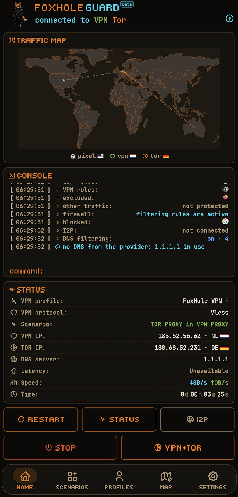
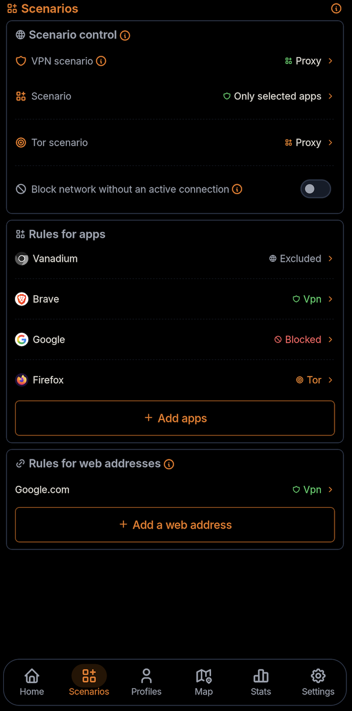
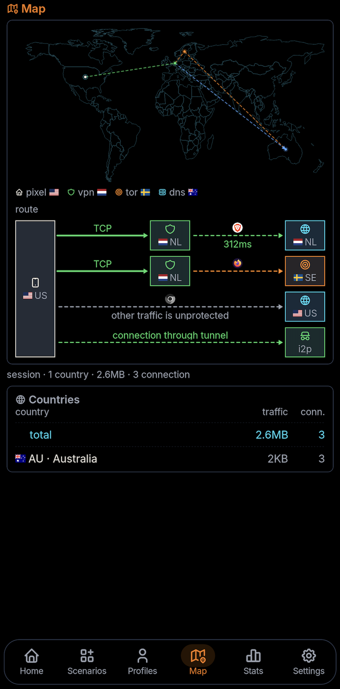
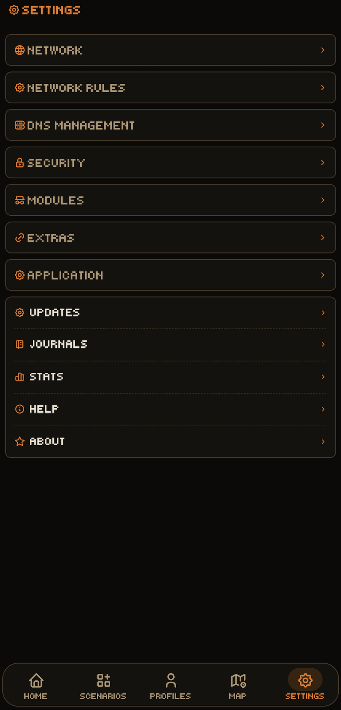

<p align="center">
    
</p>

<div align="center">

[](../README.md)
[](README.ru.md)
[](README.de.md)
[](README.fr.md)
[](README.es.md)
[](README.ja.md)
[](README.zh.md)

</div>

<p align="center">
  <a href="https://github.com/foxhole-team/foxhole-guard/releases">
    
  </a>
  <a href="https://f-droid.org/packages/com.foxhole.guard/">
    
  </a>
  <a href="https://apps.obtainium.imranr.dev/redirect?r=obtainium://app/%7B%22id%22%3A%22com.foxhole.guard%22%2C%22url%22%3A%22https%3A%2F%2Fgithub.com%2Ffoxhole-team%2Ffoxhole-guard%22%2C%22author%22%3A%22FoxHole%20Team%22%2C%22name%22%3A%22FoxHole%20Guard%22%2C%22preferredApkIndex%22%3A0%2C%22additionalSettings%22%3A%22%7B%5C%22apkFilterRegEx%5C%22%3A%5C%22arm64-v8a-release%5C%5C%5C%5C.apk%24%5C%22%2C%5C%22invertAPKFilter%5C%22%3Afalse%2C%5C%22verifyLatestTag%5C%22%3Atrue%7D%22%2C%22overrideSource%22%3A%22GitHub%22%7D">
    
  </a>
</p>

# FoxHole Guard


[](https://www.gnu.org/licenses/gpl-3.0.html)


**FoxHole Guard** 是 Android 网络防护、隐私保护和本地网络活动管理工具。

已发布版本和 APK 列在 [GitHub Releases](https://github.com/foxhole-team/foxhole-guard/releases) 中。

应用将自主开发的 **Rust 原生 FoxHole Core** 与 VPN、Tor、I2P、本地防火墙、DNS 过滤、网络监控、网页应用和代理服务器整合在一起。

项目希望用一个应用提供日常网络防护、VPN 及 Tor/I2P 匿名网络接入、应用流量路由，以及异常网络活动和未经授权安装的本地检测。FoxHole Guard 记录系统事件、应用安装和卸载及网络流量异常。

**FoxHole Guard** 不包含广告、使用情况分析或遥测。应用列表、统计、日志、路由规则及本地分析结果保留在设备上，除非用户明确导出。

|  |  |
| :---: | :---: |
|  |  |

---

## ✨ 主要功能

- **FoxHole Core**：自主开发的 Rust 网络核心。
- **VPN 协议**：VLESS、VMess、Hysteria2、WireGuard、AmneziaWG（实验性支持）、Trojan、Shadowsocks、Naive、TUIC 和 AnyTLS。
- **Tor 接入**：在 TCP VPN 隧道内连接 Tor，支持指定应用路由、网桥和定时更换 Tor 电路。
- **I2P 接入**：通过独立 `i2pd` 进程与 FoxHole Core 的本地 SOCKS5 接口访问 `.i2p` 资源。
- **防火墙**：应用封锁、断线保护和新安装应用隔离。
- **DNS 管理**：本地拦截器、UDP/TCP/DoT/DoH、缓存和过期缓存。
- **流量地图**：在世界地图上显示设备当前连接。
- **FoxHole Sentinel**：可选的本地 IOC 和网络异常分析，默认关闭。
- **网页应用**：HTML5 应用及通知投递。
- **代理服务器**：局域网内经过身份验证的 SOCKS5 和 HTTP CONNECT 代理。
- **路由器管理公开测试版（OpenWrt）**：从设置管理初始设置、配对、VPN 配置、设备路由和协议软件包。
- **后台服务**：`foxhole watchdog web` 和 `foxhole watchdog guard` 分别处理网页通知及安全事件监控。
- **安全检查**：通过安装/卸载日志、网络异常及新应用威胁指标和权限检查发现入侵或干预迹象；支持自定义应用数据加密。

---

## 🧭 架构与运行方式

### 🔁 应用控制流程

```text
application
        ↓
operating mode  →  scenario  →  traffic routing rules
        ↓
modules  ·  extensions  ·  background services
```

- **模式**决定 VPN 和/或 Tor 中哪个连接使用 Android 系统 VPN 隧道。
- **场景**决定如何向设备应用 VPN 和 Tor 路由。
- **规则**决定应用和网站如何使用 VPN/Tor 路由。
- **模块与扩展**可与任何活动模式并行工作。
- 启用的**后台服务**在 Android 平台限制范围内持续运行。

### 👤 用户与专家界面

**用户**显示精简仪表盘、连接控件和配置选择器。**专家**显示额外的诊断与调整。此选项仅改变展示方式，与路由规则、安全同意及高级设置相互独立。

可在设置或首次外观设置中选择用户或专家模式。模式选择器按内容调整高度、向上展开，并带有轻微触觉反馈。应用主页的 OpenWrt 快捷图标默认开启，dock 快捷图标默认关闭。这两个独立选项只改变图标可见性；OpenWrt 设置始终可访问，路由器、路由和配对策略均不改变。

### 🎛️ 运行模式

支持三种主要模式：

| 模式 | 说明 |
| --- | --- |
| **VPN** | 标准 VPN 隧道。 |
| **Tor** | 通过 Arti 连接 Tor。无需 VPN 配置，但必须启用 Tor 模块。 |
| **VPN 与 Tor** | 同时运行，分别使用独立场景。 |

### 🧩 模式场景

场景控制模式。在 **VPN 与 Tor** 模式下，两者的场景相互独立。

| 场景 | 含义 | 可用连接 |
| --- | --- | --- |
| **整个设备** | 设备全部流量经过隧道。 | VPN, Tor |
| **代理：指定应用** | 仅路由选定应用。 | VPN, Tor |
| **代理：排除指定应用** | 路由其他所有应用。 | VPN |
| **代理服务器** | 使用设备活动连接的 Android 代理。 | VPN |
| **局域网代理服务器** | 使用设备活动连接向局域网提供代理。 | VPN, Tor, Mixed |

VPN 活动时，将全设备流量同时交给 Tor 存在限制。如果 Tor 在活动 VPN 隧道之外运行，将使用指定应用场景。局域网代理的 Mixed 模式将 SOCKS5 流量交给 VPN，将 HTTP CONNECT 流量交给 Tor。

### 🔀 流量路由规则

规则在当前模式与场景中生效：

- 按应用选择 VPN 或 Tor；
- 防火墙启用时，**禁止联网**和**排除 DNS 过滤**规则在三种模式中持续有效；
- 网站规则支持域名、后缀和 CIDR 范围；
- 支持独立 DNS 策略；
- 支持断线封锁、新应用隔离及 TTL 规则。

| 规则 | 整个设备 | 代理场景 |
| --- | --- | --- |
| 应用 → VPN | 不应用 | 应用 |
| 应用 → Tor | 不应用 | 应用 |
| 应用 → 排除 | 应用 | 应用 |
| 应用 → 封锁 | 应用 | 应用 |
| 网站地址规则 | 应用 | 应用 |

**整个设备**场景忽略普通路由规则，但保留封锁与排除。系统隧道或防火墙未运行时，封锁规则不会生效。

路由规则以原子方式应用。场景更改默认也以原子方式应用，可在设置中关闭此行为。

---

## 🧱 模块

模块独立于运行模式配置；功能不需要活动网络路由时，可以独立工作。

| 模块 | 说明 |
| --- | --- |
| **流量地图** | 在世界地图显示当前连接。 |
| **统计** | 按应用、VPN 配置和 DNS 过滤进行本地统计。 |
| **日志** | 应用、网络与安全日志。 |
| **防火墙** | 应用封锁和新应用隔离。 |
| **Tor** | Arti：TCP、`.onion`、网桥和定时更换电路。 |
| **I2P** | 独立 `i2pd` 进程和回环 SOCKS5 提供 `.i2p`。 |
| **FoxHole Sentinel** | 应用审计、IOC 匹配及带哈希链完整性验证的日志。 |
| **DNS** | DoT/DoH 和本地过滤。 |

### 🧅 Tor 接入

通过 **Arti** 实现。

支持：

- 在 TCP VPN 协议内接入 Tor；
- 网桥；
- 断线时禁止网络访问；
- 按配置的时间间隔更换电路；
- 指定应用路由。

Tor 模块包含在 FoxHole Core 的标准 Android 构建中。

#### 🌐 Onion 服务

FoxHole Core 支持 onion 服务。

### 🕸️ I2P 接入

I2P 并未在 FoxHole Core 内实现。

它使用仅支持 TCP 的回环 SOCKS5 接口连接独立 `i2pd` 进程。

I2P 路由条件采用失败即阻断的检查方式：

- 从任何应用拦截 `.i2p` 链接；
- 向 I2P 网络转发流量；
- 移动网络使用限制；
- 带宽管理。

### 🧱 防火墙

使用 FoxHole Core 共享路由策略。

支持：

- 应用封锁；
- `Block` 优先于允许路由；
- 按应用规则；
- 网络隔离；
- TTL 规则；
- 断线保护；
- 添加拒绝规则后，立即定向撤销活动流代理；L3 数据包隧道流在空闲超时后重新评估；
- 无效重载返回类型化错误。

### 🛡️ FoxHole Sentinel

Sentinel 是 FoxHole Guard 可选的本地安全监控模块，默认关闭。启用后，后台任务由 `foxhole watchdog guard` 运行。

它组合独立的入侵指标、网络活动、静态应用分析和行为信号。结果在本地处理，不发送给开发者。

Sentinel 不定位为杀毒软件。它展示可观测指标、来源与置信程度，并区分已确认 IOC 匹配与启发式怀疑。

#### ✅ 已实现

当前包括：

- **Echap Stalkerware Indicators**：本地检查已知跟踪软件指标；
- **网络 IOC 匹配器**：将 Core 实时事件流与已知域名、IP 地址匹配，由 Sentinel 分析开关启用；
- 有界 APK/DEX 检查及可选 YARA-X 规则，在隔离扫描进程内处理已验证的传统 DEX 字节，并报告不完整覆盖；
- 静态 DEX 结构和 API 引用指标，不执行应用代码；
- 上传、后台和总流量突增、新目的国家、DNS 拦截比例、重连风暴、延迟变化及休眠应用网络活动的统计告警；
- 将 IOC 与网络流所属应用进行本地关联；
- 防火墙与隔离集成；
- 通过有界 Core 事件流审计。

IOC 匹配是安全信号，但本身并非设备已遭入侵的确定证据。

FoxHole Core 不保存持久的用户 Guard 日志。Core 暴露有界事件流，Android 应用保存长期日志。消费端跟不上时，审计接口明确报告 `dropped` 事件。

#### 🧪 计划功能

架构允许继续扩展本地分析。以下功能**尚未实现，不属于当前版本**：

- 原生库机器码分析及更广泛的加壳和反分析检测；
- DEX 与 Android API 序列行为分析；
- MITRE ATT&CK Mobile 关联；
- 高级应用网络行为分析；
- 信标式活动检测；
- 类 DGA 的 DNS 指标；
- 超出当前有界流量窗口统计的丰富行为基线；
- 将静态、IOC、Android 和网络证据汇总为单一发现的关联引擎。

这些检测器计划在本地运行，不进行云扫描，不发送 APK、已安装应用列表或网络历史。

#### 📜 安全日志

应用可保存加密的本地日志，包括：

- 应用安装；
- 更新；
- 卸载；
- 安全事件；
- 指定网络事件。

使用哈希链验证完整性。

---

## 🔌 支持的协议

| 协议 / 模式 | 支持范围 |
| --- | --- |
| **VLESS** | raw, WebSocket, HTTP Upgrade, gRPC/HTTP-2, XHTTP stream-one (HTTP/2), TLS, Reality, Vision, UDP-over-stream, XUDP, packetaddr |
| **VMess** | AEAD (`alterId=0`), raw, WebSocket, HTTP Upgrade, gRPC/HTTP-2, XHTTP stream-one (HTTP/2), TLS, TCP/UDP |
| **Hysteria2** | QUIC/H3、认证、Brutal、TCP/UDP、Salamander 混淆、单个受保护本地 UDP 套接字上的目标端口跳变、重连 |
| **WireGuard** | 自实现 Noise_IKpsk2 握手、L3 数据路径、`reserved`，导入 `wg://` 与 `.conf` |
| **AmneziaWG** (实验性支持) | `Jc/Jmin/Jmax/S1..S4/H1..H4`、经过检查的报头范围、2.0 模板 `I1..I5`、`RandomTrailers`、内容填充及 `HeaderProtectionKey` |
| **Trojan** | TLS, WebSocket, HTTP Upgrade, gRPC/HTTP-2, XHTTP stream-one (HTTP/2), TCP/UDP |
| **Shadowsocks** | AEAD 与 AEAD-2022、TCP/UDP |
| **Outline** | Shadowsocks 变体，并非独立协议 |
| **Naive** | 原生 HTTP/2 CONNECT 和协议填充 |
| **TUIC** | 独立实现的 v5、QUIC、TLS-exporter 认证、TCP/UDP、分片、重连 |
| **AnyTLS** | 独立实现的 v2、TLS 认证、填充、会话复用/多路复用、TCP 和 UoT v2 UDP |
| **SOCKS5** | CONNECT、UDP ASSOCIATE、认证 |
| **HTTP 代理** | HTTP CONNECT、认证 |
| **Tor** | Arti、TCP、`.onion`、网桥 |
| **I2P** | 连接独立 `i2pd` 进程的仅 TCP 回环 SOCKS5 适配器 |

Reality 是受支持的流传输（包括 XHTTP stream-one）下层的安全层。Vision 要求 raw TCP。其他 XHTTP 模式和不支持的设置会被拒绝。

### ↔️ Shadowsocks 与 Outline

Outline 被视为 Shadowsocks 变体。

配置支持分享链接、v2rayTun 订阅、SIP008 JSON 及兼容的 Clash/mihomo YAML。动态 Outline 密钥（`ssconf://`）保留来源用于刷新和分享。会报告不支持的条目和客户端设置，不下载外部 YAML 提供器。

支持：

- AEAD；
- AEAD-2022；
- 兼容 AEAD 配置中的 Outline `prefix=`；
- WebSocket 模式的 SIP003 `v2ray-plugin`；
- `http` 和 `tls` 模式的 `simple-obfs`。

### 🚫 不支持

**ShadowsocksR（SSR）**已弃用且不受支持。

---

## 🌐 DNS

### 🧭 DNS 管理

FoxHole Core 包含自主 DNS 拦截器。

支持：

- UDP DNS；
- TCP DNS；
- DoT；
- DoH；
- 受保护 DNS 套接字；
- 通过指定 Android `Network` 引导 DNS；
- 缓存；
- 过期缓存；
- fake-IP；
- 感知路由的 DNS。

### 🧹 DNS 过滤

FoxHole Guard 可应用本地规则过滤：

- 广告；
- 跟踪器；
- 遥测；
- 潜在恶意域名。

规则来自开放的 AdGuard DNS 过滤器。上游按名称固定，其他来源的订阅将被拒绝。

清单：

```text
https://foxhole-team.github.io/foxhole-db/manifest.json
```

下载的 DNS 规则是**过滤数据，而非可执行代码**。

使用前会验证格式参数，包括签名、大小、兼容性与 SHA-256。

验证失败时保留已安装的可信规则。首次安装后，在规则通过验证前 DNS 过滤不可用。

---

## 🔐 TLS 与受保护套接字

FoxHole Core 使用带证书验证的 Rust TLS 栈。

支持：

- WebPKI 验证；
- SNI；
- ALPN；
- SPKI SHA-256 固定；
- `insecure` 兼容模式。

`insecure` 不是安全的默认选择，需要用户明确同意。

FoxHole Core 创建的每个 Android 出站套接字均按以下流程处理：

```text
protect(fd)
    ↓
bind to Android Network
    ↓
connect / send
```

---

## 🧩 扩展与附加功能

扩展为主应用提供更多功能。

| 扩展 | 说明 |
| --- | --- |
| **代理服务器** | 通过 SOCKS5/HTTP CONNECT 向当前 Wi-Fi 的其他设备提供访问，强制认证并绑定已确认网络。 |
| **网页应用** | 全屏 HTML5 网站，各自在隔离 WebView 配置中运行并支持通知。 |

### 🔗 代理服务器

向当前 Wi-Fi 的其他设备共享活动路由。

- SOCKS5 和 HTTP CONNECT；
- 强制认证；
- 网络变化会禁用代理并使凭据失效。

路由预设：VPN、Tor、Mixed；其中 SOCKS5 经 VPN，HTTP CONNECT 经 Tor。

### 🖥️ 网页应用

每个网页应用拥有独立 ASCII 标识，供 FoxHole Core 路由策略使用。

- 按应用隔离存储；支持多配置的 WebView 为各应用提供独立 Cookie、存储和缓存，否则使用带浏览器源隔离的共享配置；
- 独立可路由租约；
- 网页应用级网络规则；
- 绑定规范源身份的通知；
- 撤销已授予租约。

可单独清除各网页应用的 Cookie、存储和缓存。完全移除网页应用也会移除其数据。

#### 🔔 网页后台服务：`foxhole watchdog web`

网页通知由独立后台服务投递。

**轮询模型。** 服务定期在隐藏 WebView 中注入 JS 适配层，读取网站计数器，无法读取时解析标签标题中的 `(N)`。这是定期而非实时投递，间隔在设置中调整。进程内定时器驱动轮询，进程被终止时由每 15 分钟一次的 WorkManager 任务兜底。并发轮询会合并，期间不加载图片。

**轮询条件。** 以下情况不轮询：

- 路由不可用：VPN 要求活动连接及本地代理桥；WireGuard/AmneziaWG 没有这种桥，因此不用于此轮询；Tor 要求活动电路，I2P 要求活动连接；`BLOCK` 始终禁止轮询；
- WebView 代理覆盖未安装：它是进程全局设置，采用失败即阻断验证；只接受具有可用端口和完整两项凭据的回环主机，否则不应用。

**轮询后。** 移除覆盖并验证移除成功。在路由改变前阻断 Service Worker 网络访问，避免后台页面越过新覆盖访问网络。前台框架独占覆盖；占用期间不启动后台轮询，无法取得所有权则不打开框架。框架绝不在分配路由之外运行。

## 🛜 路由器管理公开测试版

在设置中打开 OpenWrt，即可配对路由器并管理其 VPN 配置、设备路由、协议软件包和 FoxHole 更新。设备兼容性及安装和更新流程仍在验证中。管理开关仅适用于所选的已保存配对；关闭它不会停止路由器 VPN。

> [!IMPORTANT]
> 目前，自动安装仅支持使用完全默认 OpenWrt 配置的路由器。
> 手动安装最新版 [FoxHole OpenWrt Client](https://github.com/foxhole-team/foxhole-openwrt-client) 后也可进行配对。
> 设置和配对时，手机和路由器必须位于同一局域网，且路由器需要能够访问互联网。

Wi-Fi 图标仅表示实际的 Wi-Fi 连接，不读取 SSID 或访问定位。搜索和新的设置/配对需要 Wi-Fi。手动地址会在可用时一次性填入当前 Wi-Fi 的私有 IPv4 网关，之后仍可编辑。

通过家庭 VPN 管理是独立选项，每个已有配对默认关闭。还需要您确认“公网 IP 地址”（路由器有公网 IP 和入站 VPN 服务），并具备可用的活动 VPN 路由。此确认不会分配地址或配置防火墙。应用可通过该 VPN 网络，使用已有的固定 TLS 身份和配对认证，尝试管理已保存的私有地址；不会开放 WAN 管理端口，也不会通过移动网络进行新的搜索或配对。 手机 VPN 的自动切换/交接仍然禁用；此选项仅用于管理路由器。

只有已配对且经过认证的路由器直接发送到应用的入站 VPN 配置，才带有独立的应用关联元数据。连接 URI、配置和 QR 格式均不改变。通用网页/QR/服务商导出仍不带标记；导入的提示本身不能建立信任。

自动识别还要求已保存的本地配置、当前配置内容及所选配对相匹配，且该配置确实通过应用自身的 VPN 连接。每次实际连接只进行一次有时间限制的检查，没有定时器、自动重试或服务商配置轮询。“重试配对”是明确的 Wi-Fi/权限/PIN 流程：认证成功前保留原有记录，绝不自动接受已改变的证书身份。

设置需要使用 APK 的 OpenWrt 25.12.5、管理员权限，以及适用于准确目标和架构的已认证目录。当前软件包与更新策略允许 `mediatek/filogic` 和 `x86/64`，但这并不证明所有路由器型号均兼容。依赖关系、内核 ABI、闪存和 RAM 也必须通过检查。

首次安装须明确接受 FoxHole OpenWRT Client 许可证，同意选项默认不勾选。独立的自动更新复选框在新安装时默认开启；可取消勾选，或稍后在路由器设置中修改。配对已有路由器会保留其更新策略。通过 CLI/backend 直接安装时，自动更新默认关闭。

应用与 LuCI 的手动更新使用同一套经过身份验证的事务。启用自动更新后，路由器每天检查并安装经过验证的 FoxHole 软件包，与应用的更新渠道独立。配置、配对及所选协议模块会保留，不升级 OpenWrt 固件或其他系统软件包。取消手机配对不会关闭路由器的更新策略。

---

## ⚙️ 后台服务

FoxHole Guard 使用两个独立后台服务。

| 服务 | 功能 |
| --- | --- |
| **`foxhole watchdog web`** | 检查并投递已添加网页应用的通知。 |
| **`foxhole watchdog guard`** | 监控事件，在受保护日志中记录安装/卸载和网络异常。 |

加固模式下，`foxhole watchdog guard` 在没有活动连接时创建前台服务以驻留内存，检测到活动连接后停止。节能模式使用定期 WorkManager 轮询。

---

## 🗃️ FoxHole DB 与数据集

[](https://github.com/foxhole-team/foxhole-db)

FoxHole DB 提供五个独立签名的数据集，由对应功能按需下载。TLS 源只携带表格，ClientHello 生成逻辑仍编译在 FoxHole Core 中。更新失败时继续使用内置或最近验证的数据表。

| 数据集 | 产物 | 格式 | 来源 | 许可证 | 版本 |
| --- | --- | --- | --- | --- | --- |
| **DNS：过滤列表** | `adguard-dns-filter.fhds` | `foxhole-dns-fst-v1` | [AdGuard DNS filter](https://github.com/AdguardTeam/AdGuardSDNSFilter) | GPL-3.0 | 每次构建固定上游提交。 |
| **Tor：内置网桥镜像** | `bridges.json` | `tor-bridges-json` | [Tor Project built-in bridges (Moat)](https://bridges.torproject.org/moat/circumvention/builtin) | 公开的审查规避数据 | `generated_at` 标记；规范化对象键，保留上游数组顺序。 |
| **FoxHole Sentinel：威胁情报** | `threat-intel.json` | `sentinel-threat-intel-json`，文档 `schema: 3` | [AssoEchap/stalkerware-indicators](https://github.com/AssoEchap/stalkerware-indicators) | CC-BY-4.0 | 每次构建固定上游提交，记录于 `threat-intel-source-info.json`。 |
| **地理数据库：IP → 国家** | `dbip-country-ipv4.csv`, `dbip-country-ipv6.csv` | `dbip-country-csv` | [DB-IP Lite via sapics/ip-location-db](https://github.com/sapics/ip-location-db) (`dbip-country`) | CC-BY-4.0 | 将上游 `package.json` 中的 `version` 写入清单。 |
| **TLS 指纹表：ClientHello 配置** | `fingerprints.json` | `tls-fingerprint-tables-json` | [FoxHole Core `fingerprints/`](https://github.com/foxhole-team/foxhole-core) | GPL-3.0-or-later | 每次固定上游版本，每个配置应用前重新计算 `fingerprint_sha256`。 |

---

## 🔒 权限与隐私

- `INTERNET`：VPN、代理、Tor、I2P、DNS、网页应用、订阅和可更新网络数据。
- `ACCESS_NETWORK_STATE` / `ACCESS_WIFI_STATE`：网络状态、规则及代理。
- `ACCESS_LOCAL_NETWORK` - 用于发现、设置和管理路由器。在 Android 17（API 37）及更高版本上，若应用的目标 API 也是 37 或更高版本，会在 LAN 操作前请求系统权限。拒绝后会阻止这些操作。
- `FOREGROUND_SERVICE` 及相关前台服务权限：带可见通知的、由用户控制的长期网络模式。
- `QUERY_ALL_PACKAGES`：分流、防火墙、隔离、DNS 排除和本地审计所需的应用列表。
- `PACKAGE_USAGE_STATS`：仅用于用户启用且需要该 Android 系统访问权限的本地统计与分析。
- `CAMERA`：导入二维码。
- `POST_NOTIFICATIONS`：网络服务、Sentinel 和网页通知。
- `RECEIVE_BOOT_COMPLETED`：重启后恢复所选模式。
- `WAKE_LOCK`：需要时维持网络会话。

以下数据保留在设备上：

- 已安装应用列表；
- 本地统计；
- 连接与日志；
- Sentinel 结果；
- 自动连接历史；
- DNS 排除；
- 防火墙策略；
- 路由策略；
- 本地网页应用数据；
- 模块与扩展设置；
- Vault 元数据。

FoxHole Guard 不将这些数据发送给开发者。

### 🌍 网络请求

FoxHole DB 的 TLS 指纹表更新默认启用。启动后可能检查一次，此后在有网络时安排每日检查，可在设置中关闭。其他签名数据集和已保存订阅有各自更新控制。

连通性检测和 IP 查询会联系 Google、Cloudflare、ipwho.is 及其他备用服务。它们会收到请求和所用公网 IP。功能相关网络活动还包括：

- VPN；
- Tor；
- I2P；
- HTTPS 订阅更新；
- 连通性检查；
- 用户配置的 DNS；
- GeoIP/DNS/Tor 网桥更新；
- 网页应用；
- 已启用网页应用的事件投递。

---

## 🤖 Android / 原生 ABI

需要 Android 8（API 26）或更高版本。FoxHole Core 通过版本化的 C/JNI ABI 连接；Capabilities API 报告构建中实际编译的协议与功能。

交付配置 `android4` 面向 `arm64-v8a`、`armeabi-v7a`、`x86` 和 `x86_64`。每种 ABI 都需要匹配的原生库和许可证数据。可用 APK 架构和文件名由实际发布版本决定；构建选项本身不能证明设备或运行时兼容性。

原生构建使用固定的 Rust/NDK 工具链，并须通过 ELF 检查。

---

## 🔏 发布验证

由所有者签名的发行 APK 使用下方证书。

GitHub 与 F-Droid 是独立更新渠道。GitHub 版支持应用内 APK 更新检查；F-Droid 版关闭 APK 自更新并移除安装软件包权限，由 F-Droid 客户端更新。每个 APK 都有自己的交付 SBOM。架构、产物可用性和版本须依据真实发布资产确认。仅有配方并不证明 F-Droid 构建成功、可复现或已被仓库接纳。

建议对官方发布 APK 验证校验和及签名证书。

```bash
sha256sum -c SHA256SUMS
```

```bash
apksigner verify --print-certs downloaded-apk.apk
```

预期证书 SHA-256 指纹：

```text
e59de2486084c38f3c77e9df0eb5eff9a4559f3c68024f1208e0e9c04b0df665
```

预期 SHA-1 指纹：

```text
9e00dc6b54461a4647cb11133b394cdfc986646d
```

---

## 🔗 相关项目

[](https://github.com/foxhole-team/foxhole-core)
[](https://github.com/foxhole-team/foxhole-core/releases)

[](https://github.com/foxhole-team/foxhole-db)
[](https://github.com/foxhole-team/foxhole-db/releases)


[](https://github.com/foxhole-team/foxhole-vpn)
[](https://github.com/foxhole-team/foxhole-vpn/releases)

[](https://github.com/foxhole-team/foxhole-openwrt-client)
[](https://github.com/foxhole-team/foxhole-openwrt-client/releases)

---

## 📄 许可证

FoxHole Guard 与 FoxHole Core 根据以下许可证分发：

**GNU General Public License v3.0 或更高版本（`GPL-3.0-or-later`）**

Copyright (C) 2026 FOXHOLE TEAM.

第三方依赖许可证列于：

- `THIRD_PARTY_NOTICES.md`；
- 项目 SBOM（`*.cdx.json`）。

依赖与许可证图在 CI 中验证。

---

## 💖 支持开发

我们完全利用自己的时间和资源，并借助 AI 工具开发和维护 FoxHole Guard。您的支持能让我们为项目投入更多时间，加快开发进度。

[支持项目 - 加密货币钱包](#cryptocurrency-wallets)

<a id="cryptocurrency-wallets"></a>

### 🪙 加密货币钱包

**XMR（Monero）：**

```text
48yBVPTdcyJ1WoJtnKmVpEZziEsDy4HvbCW7eQDS9mfdiWPFXwZ8F5h9YZ2UTTBLxPcJgQgvth7iqLZM2yMCaQ432qaouqr
```

**BTC（Bitcoin）：**

```text
bc1qatnyy7jcpqrp0d3dk9rta9vqfejgh4mysd6m2f
```

**ETH（Ethereum）：**

```text
0xDEBA357Cc8f5E865ea7FFa98E138C8241A16A465
```

---

## ⚠️ 声明

- Tor 是 The Tor Project 的商标。FoxHole Guard 不是其产品，未获其认可或赞助，与其无隶属关系。
- FoxHole Guard 不是 AdGuard 的产品，与 AdGuard Software Ltd. 无隶属关系。
- FoxHole Guard 不是 I2P 或 PurpleI2P 的官方产品。
